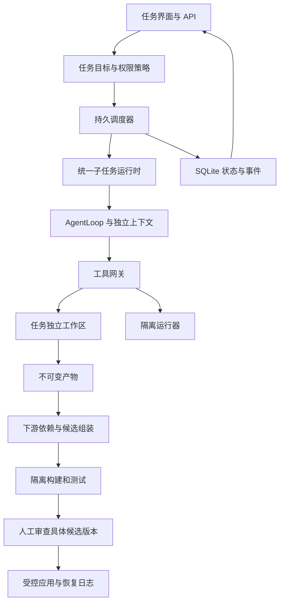

# Pilot 多智能体生产级开发计划

版本 0.1；日期 2026-10-28；状态 开发规划。

适用范围 个人和小团队在人工审查下开发真实软件项目

当前执行链和模块职责见[项目模块与技术导览](PROJECT_TECHNICAL_GUIDE.md)。本计划中的 Linux 隔离运行器优先是初始排期假设；后续讨论增加了自研统一执行层、Windows 原生限制优先和容器可选的候选方向。执行后端选型待原型验证，确定后应更新 M2 的支持范围和工期。规划中的类和能力不能视为当前已经实现。

Pilot 的第一阶段目标是让多智能体开发具备可执行的权限边界、互不覆盖的工作区、可恢复的任务状态，以及绑定到具体代码版本的验收结果。保留 Java、Spring Boot、AgentLoop、现有 HTTP 和 SSE 界面，逐步替换当前子任务派发与沙箱实现。

生产级 v1 面向本机使用和受控的单用户部署。用户可以委托调研、独立实现、补测试和集成验证，审查通过后将候选改动合入自己的工作区。多人远程服务、租户隔离和自动部署属于后续独立版本。

工期按两名全职开发、测试和安全评审支持可用估算，总体为 12 至 16 周，包含集成和修复余量。这是排期假设，不是交付承诺；一名开发者可先按 24 至 32 周评估。Linux 隔离运行器作为命令执行的首个生产支持环境；macOS 可通过 Linux 容器虚拟机连接运行器。原生 macOS 和 Windows 沙箱分别立项，不计入这次估算。

## 对标产品和采用范围

下表的公开能力来自官方文档。Pilot 的架构和验收门槛是本项目的设计选择，不代表其他产品的内部实现或实测水平。

| 对标对象 | 已公开且与本项目有关的机制 | Pilot 采用的设计 | 当前成熟度边界 |
| --- | --- | --- | --- |
| Codex | 子 Agent 使用独立上下文并继承父会话权限；独立聊天可使用 Git worktree；命令受到沙箱约束 | 权限只收紧、调研结果摘要回传、可检查的子任务、代码工作区与命令沙箱分层 | 子 Agent 的独立上下文不意味着自动获得独立文件系统；不能把聊天 worktree 与子 Agent 默认执行位置混为一谈 |
| Claude Code | 可配置子 Agent 的描述、工具、模型和权限；支持 worktree 隔离；另有共享任务和消息的 Agent Teams | 专用角色、工具能力明确裁剪、独立工作区、按任务需要选择协作方式 | Agent Teams 官方仍标注实验功能，v1 不依赖开放式互聊和嵌套团队 |
| ZCode | Explore 只读调研与通用子 Agent 分工；目标模式按产物和验证结果持续推进；操作确认归属当前任务 | 只读探索角色、持续目标卡、明确的完成证据、权限与任务界面联动 | 自定义子智能体标注 Beta；公开文档不能证明其内部隔离强度 |
| DeepSeek dsh | 子任务管理统一处理创建、容量、父子关系、取消和结果；支持持久会话与后续输入；区分下一轮消息和当前步骤纠正 | 统一子任务运行时、持久输入箱、资源释放后结算、明确父子所有权 | 仓库整体仍为开发者预览，公开 API 可能发生破坏性变化 |

来源：[Codex 子 Agent](https://learn.chatgpt.com/docs/agent-configuration/subagents)、[Codex worktree](https://learn.chatgpt.com/docs/environments/git-worktrees)、[Codex 沙箱](https://learn.chatgpt.com/docs/sandboxing)、[Claude Code 子 Agent](https://code.claude.com/docs/en/sub-agents)、[Claude Code Agent Teams](https://code.claude.com/docs/en/agent-teams)、[ZCode 子智能体](https://zcode.z.ai/cn/docs/subagents)、[ZCode 目标模式](https://zcode.z.ai/cn/docs/goal)、[ZCode 操作确认](https://zcode.z.ai/cn/docs/safety-confirm)、[dsh 子任务服务](https://github.com/deepseek-ai/deepseek-harness/blob/master/packages/subagent/subagent/README.md)、[dsh Agent](https://github.com/deepseek-ai/deepseek-harness/blob/master/packages/core/agent/README.md)、[dsh 项目状态](https://github.com/deepseek-ai/deepseek-harness)。核对日期为 2026-10-28。

## 当前实现和需要关闭的缺口

规划所依据的仓库 HEAD 为 `1e9d2cdd8755238853c9e266a5c31b86c0a2444e`，工作区还包含未提交修改。正式实施前应冻结新的基线并重新运行测试，不把 HEAD 当作全部工作区内容的标识。

| 编号 | 当前情况 | 实际影响 | 现有入口 |
| --- | --- | --- | --- |
| G1 | 调度子 Agent 内部使用 AUTO，命令直接运行在真实工作区；文件范围没有传递为进程访问边界 | 临时目录实测：只读任务的文件工具拒绝访问某文件，命令工具仍可改写该文件 | `MultiAgentService.runOnce`、`WorkspaceToolFactory.registryForScope`、`RunCommandTool` |
| G2 | 沙箱编辑从真实文件读取原文，再覆盖同路径提案；读取工具也只看真实文件 | 临时目录实测：对同一文件连续改两处，最终提案丢失第一处修改；新文件也无法在接受前正常复读 | `SandboxEditFileTool`、`SandboxCreateFileTool`、`DiffSandbox` |
| G3 | DAG 依赖主要控制启动顺序，没有把上游产物装入下游工作区或上下文 | 后端接口已经在上游生成，下游仍可能读取旧接口或根本看不到新文件 | `MultiAgentService.dispatch`、`runOnce`、`userPrompt` |
| G4 | 校验跳过仍可能被计入整批完成；接受接口没有校验状态硬约束 | 未运行校验的改动能进入接受流程；选择部分沙箱后也没有重新验证该候选组合 | `MultiAgentService.dispatch`、`MultiAgentController.accept` |
| G5 | `spawn_agent` 持有父工具注册表，同一表随后被注册派生工具；子运行事件直接传父出口 | 递归派生、真实文件写入和子运行污染父状态缺少可靠边界 | `SpawnAgentTool`、`AgentRunService.execute` |
| G6 | 仲裁结果主要保存为事件，未完成可恢复的调度状态迁移 | 父 Agent 是否停止、选定方案如何恢复下游，仍依赖模型理解文字 | `MultiAgentController.resolve`、`MultiAgentService` |
| G7 | 沙箱和任务看板以内存为主，JSON 是审计副本；缺少子任务恢复模型 | 重启后无法完整找回待接受产物和执行位置 | `SandboxStore` |
| G8 | 已有组件测试和测试映射，缺少冻结仓库上的真实模型任务评估 | 测试通过不能证明复杂开发任务的成功率、成本和恢复能力 | `evaluation/TASKS.md`、`evaluation/REPORT.md` |

保留已有项目制导航、目标和验收卡、会话持久化、检查点、权限审批、命令任务管理及 trace。新方案应接入这些能力，避免形成第二套互不关联的任务和命令系统。

## 生产级 v1 的交付边界

| 能力 | v1 要达到的行为 | 暂缓范围 |
| --- | --- | --- |
| 调研 | 独立上下文，可审查证据；只读角色不能获得通用命令或写工具 | 自动构建任意规模的长期知识图谱 |
| 实现 | 每个工作任务拥有可读回自身修改的独立工作区 | 多个 Agent 无约束地写同一可变工作区 |
| 调度 | 星型父子关系、依赖产物传递、取消、重试、恢复、容量控制 | 子 Agent 自由递归组队和任意横向通信 |
| 验证 | 在确切候选版本上执行配置的构建与测试，保存原始结果 | 用模型评价代替项目验收命令 |
| 接受 | 审查某一完整候选版本后应用；版本变化使旧验证失效 | 自动推送、合并远端主分支和部署 |
| 执行环境 | 受控 Linux 隔离运行器；没有可用隔离后端时禁用自主命令 | 面向不可信租户的强隔离云服务 |
| 部署 | 单用户、本地优先；本机入口也具备访问令牌和来源校验 | 开放公网、多组织权限和分布式调度 |

## 架构决定

### 保留现有技术栈并统一子任务入口

`pilot-core` 保留纯 Java 领域模型与执行契约，`pilot-server` 装配存储、调度和运行器，`pilot-web` 展示同一状态来源。优先保持单体服务与 SQLite，不为单用户版本引入微服务或外部消息队列。

新增统一的 `SubagentRuntime`。`spawn_agent` 和 `dispatch_agents` 作为兼容入口转到同一运行时，不再各自构造不一致的 AgentLoop。旧 `spawn_agent` 默认适配为只读探索任务；实现任务必须明确获得工作区和修改能力。持久化工具调用和历史事件仍按原版本读取。

### 权限只能继承或收紧

有效能力由系统策略、会话授权、父 Agent 能力、角色能力和任务范围共同限制。任何一层拒绝就不能执行。子任务配置、项目文件和模型生成的任务参数不能扩权。

将文件读取范围和写入范围分开；将进程、网络、工具和敏感凭据访问作为单独能力。空任务白名单不得解释为自动获得全部能力。文件 deny 规则同样适用于运行器实际可见的文件；不能一边声称文件不可见，一边把整个宿主目录挂给命令。

只读探索可以在 READ_ONLY 会话中启动，前提是服务器解析并确认它只包含读取能力。当前固定的 `Tool.readOnly()` 不足以判断混合任务派发，应加入依赖已验证参数的委派权限检查。可写任务和需要命令的任务继续遵守父会话审批策略，批准一次派发不代表批准全部未来命令。

### 独立工作区与进程隔离分别实现

`WorkspaceBackend` 管理代码版本和子任务文件状态。实现任务使用独立 checkout 或物化快照，读、搜索、创建、编辑、命令看到相同内容；diff 从初始基线和最终文件树计算。纯调研可共享不可变只读快照。

任务基线必须记录 commit、暂存和未暂存改动、允许的未跟踪文件、删除、二进制及文件模式。文件大小和策略限制导致快照不完整时拒绝执行或明确要求调整，不能静默漏文件。不得自动 stash、reset 或覆盖用户正在工作的目录。未纳入 Git 的项目使用目录快照后端，生产自主执行支持可晚于 Git 后端。

`ExecutionBackend` 提供进程和网络边界。首个生产后端运行在专用 Linux 容器或隔离运行器中：非 root、无特权、只挂任务文件和专用缓存、没有宿主目录及 Docker socket、宿主凭据不注入、默认禁止外网，并设 CPU、内存、进程数、磁盘和日志配额。需要依赖下载时通过单独批准的网络配置和受控出口执行。

Git worktree 共享仓库元数据，所以工作区独立不等于安全隔离。运行器不能获得可写的宿主共享 Git 元数据；向运行器提供过滤后的任务快照或私有 Git 副本。构建脚本、测试脚本和验证命令都按项目代码执行，也必须进入隔离运行器。多租户场景另行评估容器逃逸威胁和虚拟机级隔离。

### 调度状态持久化并异步执行

派发先持久保存图、节点、输入和权限快照，成功后返回 `dispatchId`，由调度器推进。模型通过等待或查询工具获取结果，长任务不把父运行线程长期阻塞在 `Future.get()`。用户仍可向父任务排队、纠正、暂停或取消。

v1 限制为父 Agent 加直接子 Agent，默认深度为 1。默认每批并发两个子任务，所有批次、重试、复核和验证还受宿主资源总配额限制。任务槽和验证槽分开计数、共同受资源上限约束，避免等待下游的父任务占满可执行槽。资源不足返回明确状态或有界排队，不进行无界线程扩张。

SQLite 记录状态迁移和待发布事件，同一事务提交后再推 SSE。调度器使用单实例所有权和带递增代次的任务租约；重启或租约失效后，旧执行者不能提交新产物。数据库保存恢复所需字段，内存只做缓存。

### 产物和依赖必须版本化

任务成功产出 `ArtifactManifest`：基线 ID、文件树摘要、补丁、报告、证据、验证记录及内容哈希。后继任务的 `InputBundle` 显式引用依赖产物版本、接口摘要和验收要求。

例如 T1 修改登录 API、T2 补前端调用、T3 做集成验证：T2 的工作区先物化 T1 的准确产物，T3 再组装 T1 与 T2。依赖状态变成成功只允许启动准备流程，不表示工作区已经自动包含上游文件。上游重试产生新版本后，旧下游标为过期，按依赖关系重新验证或执行。

文件不重叠不代表可以直接串行覆盖整份内容。多个产物改同一文件时执行真正的补丁或三方合并；重叠失败进入人工处理。禁止用最后一次 `writeString` 覆盖来冒充合并。

### 验证和接受绑定同一个候选版本

验证状态采用 `NOT_RUN`、`RUNNING`、`PASSED`、`FAILED`、`SKIPPED`、`CANCELLED`。有代码改动时只有所需检查全部 `PASSED` 才进入可接受状态。纯调研可以完成但不产生可应用代码；项目没有适配的验证命令时，结果显示未验证，不能进入生产接受流程。

`VerificationReport` 记录候选文件树哈希、基线、选定产物集合、验证命令、运行器和工具链版本、依赖锁文件、退出码、日志引用、时间和策略版本。完整读取或持续排空子进程输出，不能因输出截断使进程阻塞。成功启动、后台命令仍在运行和没有异常文本，都不能算验证成功。

接受请求携带 `candidateHash`、`expectedWorkspaceRevision` 和 `idempotencyKey`。服务端检查权限、必要审批、未解决仲裁、验证结果和当前工作区指纹。选择部分沙箱、修改文件或更换验证配置后，必须产生新候选并重新验证。

代码应用使用工作区锁、全量预检、备份和写前操作日志。先完成准备再写入，失败时回滚，崩溃后根据日志恢复或标为需要人工修复。普通文件系统不提供跨多文件原子事务，不能只靠 SQLite 事务承诺文件原子性；外部编辑器也不遵守服务锁，仍要做指纹冲突检测。出现外部修改时保护用户内容，停止应用。

### 仲裁由状态机执行

语义相近的结论不能靠移除标点后字符串比较来判断一致性。复核报告使用结构化字段：主张、证据引用、产物版本、风险和阻塞原因；先比较可验证事实和代码产物，再决定是否需要人工判断。

编译或测试失败不进入“选一个看起来不错的方案”的仲裁。调度器可按明确策略将失败日志交回原任务做有限修复；超过预算后停止。需求含糊、方案互斥、真实合并冲突和高风险取舍进入 `AWAITING_DECISION`。

仲裁记录允许的选项、关联任务和候选版本。用户选择后在事务中保存决定、废弃未选产物、使受影响的下游和旧验证失效，再明确恢复调度。需要用户决定时不因超时默认批准；权限请求也不自动批准。父 Agent 不能用一句“我选择 A”绕过阻塞状态。

## 状态和数据契约

### 调度和执行状态

| 对象 | 主要状态 | 状态约束 |
| --- | --- | --- |
| 调度图 | DRAFT、RUNNING、PAUSING、PAUSED、AWAITING_DECISION、AWAITING_ACCEPTANCE、COMPLETED、FAILED、CANCELLED | 有未结束子任务、阻塞仲裁或未接受代码时，不能标为已交付 |
| 子任务 | PENDING、READY、RUNNING、SUCCEEDED、FAILED、BLOCKED、CANCELLED | SUCCEEDED 代表产物生成成功，集成验证仍由候选版本状态决定 |
| 单次尝试 | CREATED、RUNNING、STOPPING、SUCCEEDED、FAILED、CANCELLED、INTERRUPTED | 重试创建新 attemptId，禁止覆盖原尝试记录 |
| 命令 | QUEUED、RUNNING、STOPPING、COMPLETED、FAILED、CANCELLED、TIMED_OUT、INTERRUPTED | 命令和进程树完成清理后才结算；重启不假装旧进程继续正常运行 |
| 代码应用 | PREPARING、APPLYING、APPLIED、ROLLING_BACK、ROLLED_BACK、NEEDS_REPAIR | 未完整应用或恢复的操作阻止同工作区后续发布 |

分别展示“子任务完成”“候选验证通过”“等待用户接受”“已交付”。复用任务卡已有人工验收要求：如果用户设置了验收条件，只有全部核对并填证据后任务才进入最终完成。

### 持久化记录

| 记录 | 最少需要保存的信息 |
| --- | --- |
| `dispatches`、`task_nodes`、`task_dependencies` | 父任务、版本、依赖、状态、验收条件、取消范围和状态 revision |
| `agent_runs`、`task_attempts` | rootRunId、parentAgentId、agentId、taskId、attemptId、模型、角色、预算、租约代次、停止原因 |
| `task_inbox` | messageId、来源身份、Queue 或 Steer、内容引用、处理位置、送达及消费状态 |
| `workspace_snapshots` | 原始工作区、完整基线摘要、任务工作区、上游产物集合、清理状态 |
| `artifacts`、`candidates` | 不可变 manifest、内容地址、选定版本、文件树哈希、审阅状态 |
| `verifications` | candidateHash、检查配置版本、命令任务 ID、退出码、日志与报告 |
| `approvals`、`decisions` | 精确操作、参数摘要、任务归属、权限版本、可选项、决定人和幂等请求 ID |
| `apply_operations` | 候选哈希、写前及目标指纹、备份引用、当前阶段和恢复结果 |
| `usage_records`、`event_outbox` | 分 Agent 用量、估算与实测标识、待发布事件及发布进度 |

引入有版本、校验和与升级测试的数据库迁移，替换不断追加临时 `ALTER TABLE` 的方式。升级前备份；不支持的旧格式明确报错或使用显式迁移。现有 JSON 审计副本可导入恢复记录，但不能自动认定旧沙箱已验证或已获批准。

### 工具与 API

| 入口 | 输入与输出要点 |
| --- | --- |
| `dispatch_agents` | 接受验证后的任务图，返回 dispatchId、状态和查询方式；客户端可带 requestId 防止网络重试重复派发 |
| `wait_agents` | 接受 dispatchId、游标及有界等待时间；返回变化和摘要，不无限重复整个历史 |
| `steer_agent`、`cancel_agent` | 明确目标 agentId、attemptId 或整个子树；校验父子所有权和当前 revision |
| `GET /api/sessions/{id}/multi` | 返回来自持久状态的图、子任务、候选、验证、仲裁和预算，不只读内存看板 |
| 仲裁 resolve | 必须匹配存在且未过期的决策、允许的选项和 expectedRevision；重复同一请求幂等，冲突选择返回 409 |
| 候选 accept | 使用 candidateHash、expectedWorkspaceRevision、idempotencyKey；接受前重新执行全部门控 |
| SSE | 每个事件有 sessionId、rootRunId、agentId、parentAgentId、taskId、attemptId、eventId 和协议版本 |

继续兼容现有 SSE 信封，新增可选归属字段和版本化 payload。子任务完成事件不能被父运行当作自身的 `run.completed`；展示层按事件 ID 去重、按持久序号补拉，重连后恢复相同状态。

### 暂停取消和重启

暂停禁止新的任务和工具进入，在可控步骤边界保存状态。取消还要终止归属该尝试的模型请求和进程树，等待清理后释放容量。进程归属绑定运行器执行 ID 或 PID 与启动时间，避免 PID 复用时误杀其他进程。

后台命令复用 `CommandTaskManager` 的状态、日志和配额能力，并增加 agentId、attemptId、runnerId 归属；不能只用 sessionId 区分所有子任务。当前尝试默认拥有它启动的全部进程，只有明确转移所有权的开发服务才允许跨尝试保留。

重启先收敛旧运行、回收可识别孤儿执行、重建输入箱和调度视图，再允许恢复。模型请求可以重新发起，但文件应用、提交、安装和外部 API 调用等副作用不能无条件重放。恢复时区分“执行成功但回执未保存”和“尚未执行”，无法判断的操作转人工确认，不承诺通用的恰好执行一次。

## 触发规则和角色设计

提供 `off`、`explicit`、`auto` 三种模式。试点默认 `explicit`，用户或适用项目指令明确要求时才委派；用户开启 `auto` 后允许模型提出拆分，但是否执行仍由服务端权限、图校验和预算决定。全局 off 对所有委派入口生效。

| 场景 | 运行方式 | 服务端条件 |
| --- | --- | --- |
| 单文件小修复、强顺序任务 | 单 Agent | 不为增加人数而委派 |
| 多目录搜索、调用链调查、互相独立的代码审查 | 并行 Explorer | 只读角色、足够预算、明确范围和预期证据 |
| 前端和后端独立实现 | 多 Worker | 每个任务有独立工作区，明确接口或前置设计产物 |
| 上游改接口、下游适配 | DAG 串并行混合 | 下游获得上游产物后才能进入 READY |
| 修改数据库、权限、支付或公共接口 | Worker 加定向 Reviewer 和 Verifier | 明确风险标记、必要人工决定及项目验收，不固定要求多个模型投票 |
| 同一文件高度耦合、上下文拆分收益小 | 单 Worker 或顺序执行 | 不允许多个任务同时竞争同一可变工作区 |
| 隔离后端缺失、预算不足、模型不支持所需工具 | 拒绝对应委派或在既有权限内退回单 Agent | 告知原因；不降级到宿主全权限执行 |

首批角色为 Explorer、Worker、Reviewer、Verifier。Reviewer 默认只读，Verifier 通过执行服务跑验证配置，模型不能自行把检查结果改成成功。角色没有必要指定不同模型；先使用相同已验证配置，后续通过对照评估再开放模型路由。

上下文按任务提供目标、约束、必要项目规则、输入产物和摘要。默认不复制全部父对话；压缩保留任务卡、权限和产物引用。界面展示派发原因、任务范围、当前步骤、验证状态和用量。角色配置中的工具清单只能收紧系统权限。

预算同时限制宿主并发、任务图节点数、直接子任务数量、重试次数、模型输入输出、总耗时和磁盘。模型服务返回的实际 token 用量单独记录；未知用量明确标为估算，不能当成零。没有可靠价格表时按 token 和请求数实施限制，界面不显示虚假的精确费用。预算耗尽进入可解释的暂停或失败状态，保留产物，不自动加额。

## 分阶段实施和验收

测试和评估贯穿各阶段。M0 固定已复现问题和第一批任务仓库，M1 在模拟模型下验证生命周期，M2 和 M3 各运行至少 10 项真实模型冒烟任务并记录失败类别，M5 才执行完整的对照和发布评估。每个阶段先冻结输入、模型和配置，再比较修复前后结果，避免到最后两周才发现设计不支持真实开发流程。

### M0 关闭已确认缺口

预计 3 至 5 个工作日。两名开发分别负责权限入口和代码沙箱，测试支持负责复现与端到端门控。

| 工单 | 工作内容 | 验收标准 |
| --- | --- | --- |
| MA-001 | 给 G1 和 G2 添加回归测试；补有代码改动时校验 skipped 的拒绝测试 | 测试准确复现现有缺口，不依赖真实模型 |
| MA-002 | 禁止只读子任务拿通用命令；停止在真实工作区为可写子任务运行命令；去掉内部无条件 AUTO | 权限收紧立即生效，任意委派都不能自动扩权；隔离运行器就绪前对应命令明确不可用 |
| MA-003 | 给现有沙箱添加统一文件覆盖视图，读、搜索、创建和编辑看到本任务最新内容 | 连续编辑、创建后复读和编辑、撤销某次修改均正确；真实工作区保持原状 |
| MA-004 | 在接受接口加入服务端验证和仲裁门控；未建立候选版本的历史产物先不允许生产接受 | 绕过 UI 直接请求接口也无法接受 failed、skipped、未验证或有仲裁的代码 |
| MA-005 | 独立子任务工具集合，过滤派生入口，隔离子事件和父终态 | 默认不能递归；子任务完成和失败均不提前结束父运行 |

M0 的交付是关闭已知漏洞和错误行为，仍不能据此宣布生产级完成。

### M1 建立统一运行时和持久状态

预计 2 周。优先顺序为身份契约、存储迁移、状态机、异步派发和旧入口适配。

| 工单 | 工作内容 | 验收标准 |
| --- | --- | --- |
| MA-006 | 实现 SubagentRuntime、RunContext、版本化 TaskSpec 和 Result | spawn 与 DAG 子任务共享同一权限、事件和取消契约 |
| MA-007 | 实现 task、attempt、inbox、decision、artifact 元数据存储和事务事件出口 | 重启可恢复待办、父子关系和未接受产物；状态与 SSE 不出现提交一半 |
| MA-008 | 引入调度所有权、租约代次、状态 revision 和请求幂等 | 同一请求重复提交只创建一批任务；旧执行者的晚到结果被拒绝 |
| MA-009 | 兼容旧工具和历史事件，移除两套运行逻辑 | 原有单 Agent、队列、纠正、检查点和人工验收回归通过 |

阶段出口：父任务可在子任务运行中排队和纠正，服务重启后图和产物可检查，不能静默重复写入。

### M2 建立独立工作区和隔离运行器

预计 2 至 3 周。先完成完整基线和文件一致性，再接入 Linux 运行器；macOS 经容器虚拟机运行同一测试集。

| 工单 | 工作内容 | 验收标准 |
| --- | --- | --- |
| MA-010 | 实现 GitWorkspaceBackend、快照 manifest 和产物归档 | 脏工作区、未跟踪文件、二进制、删除、模式变化和同文件多次编辑不丢失 |
| MA-011 | 实现 ExecutionBackend 和运行器能力探测 | 命令只能访问任务授权视图；宿主目录、Git 元数据、凭据、网络和 socket 访问测试按策略拒绝 |
| MA-012 | 接入命令任务归属、日志、资源配额、进程树取消和清理 | 前台和后台命令同样受限；取消后释放进程、容量和临时文件；日志满额不使运行无限阻塞 |
| MA-013 | 实现构建依赖缓存、初始化配置和运行器健康检查 | 缓存不可用于改写其他任务；隔离能力缺失时拒绝执行并显示原因 |

阶段出口：Worker 可以在自己的文件树里完成“修改、复读、运行测试”，其他任务及用户目录不受写入影响。工作区机制的正确性和进程安全边界分别通过测试。

首版风险处理：用 M0 的回归测试和最小构建仓库，提前验证 Linux 容器与 macOS 容器虚拟机的挂载、启动时间、文件权限、JDK 和 Node 工具链及离线依赖体验。如果关键限制无法满足，尽早选择专用远程运行器或调整支持范围，不通过放开宿主权限解决。

### M3 完成依赖集成验证和受控应用

预计 2 周，依赖 M1 和 M2。

| 工单 | 工作内容 | 验收标准 |
| --- | --- | --- |
| MA-014 | 实现 ArtifactManifest、InputBundle、上游版本失效和候选组装 | T2 读取 T1 新增接口；T1 重做后 T2 和旧验证明确过期 |
| MA-015 | 实现真正的补丁或三方合并，输出可操作的冲突 | 不重叠改动都保留；冲突不自动丢弃一方；新建同名文件阻断集成 |
| MA-016 | 重构 VerificationGate，支持显式项目检查配置 | Maven、Gradle、Node 验证按配置运行；无合适配置时保持未验证；非 Java 项目的扩展通过同一接口接入 |
| MA-017 | 实现候选版本接受、工作区锁、恢复日志和幂等写入 | 验证版本和接受版本完全一致；半途写入失败可恢复；部分选择必须重新验证 |

阶段出口：完成后端修改、前端适配和集成测试的三节点任务，用户可审查完整候选并可靠接受或拒绝。

### M4 完成用户控制和可观察性

预计 1 至 2 周，可在 M3 后期开展界面工作。

| 工单 | 工作内容 | 验收标准 |
| --- | --- | --- |
| MA-018 | 实现暂停、取消、纠正、有限重试与仲裁恢复 | 用户决定仅恢复相关任务；拒绝或过期决定不会放行；父停止后没有新子任务开始 |
| MA-019 | 实现 off、explicit、auto 与角色权限 | 相同输入在各模式下行为符合配置；READ_ONLY 能做受限探索但不能执行可写任务 |
| MA-020 | 展示任务树、来源、候选 diff、验证、等待原因、预算和日志 | 重连不重复任务、不丢待审批；界面和服务端状态一致；部分成功不显示整批交付 |
| MA-021 | 记录分 Agent 用量、排队和执行耗时、失败原因、资源及清理结果 | 能定位一次失败来自模型、工具、隔离、集成、验证还是发布；未知用量标为未知 |

阶段出口：开发者能从界面判断谁在做什么、为什么等待、代码是否验证，以及暂停或继续会影响哪些任务。

### M5 完成发布验证和受控试点

预计 2 周，另留 1 至 3 周处理集成、环境和试点发现的问题。

| 工单 | 工作内容 | 验收标准 |
| --- | --- | --- |
| MA-022 | 固定任务仓库、模型和配置，执行单 Agent 对照与多 Agent 真实评估 | 成功率、干预、耗时、token 和误报完成都有原始记录，不从单元测试推导模型成功率 |
| MA-023 | 注入断网、限流、进程退出、强制重启、重复请求、磁盘满和日志满 | 无未授权执行、无重复接受、无静默丢代码；不确定副作用进入待处理 |
| MA-024 | 实施本机入口保护、凭据隔离、审计脱敏、备份和迁移演练 | 默认仅监听 loopback；非授权客户端和跨来源状态修改被拒绝；运行器拿不到模型主密钥 |
| MA-025 | 增加运行器镜像锁定、升级检查、回滚说明、清理策略和 CI | 从干净机器按文档启动；升级前有备份；运行器不可用时不会退回宿主裸执行 |

阶段出口：满足以下发布门槛后进入受控试点；试点期间从只读和独立模块任务逐步扩大授权范围。

## 发布门槛和评估方法

下面的数值是 Pilot v1 的建议发布标准，不是对标产品的成绩，也不是当前已经实现的结果。

| 维度 | 建议门槛 | 测量方式 |
| --- | --- | --- |
| 已知缺口 | G1 至 G7 均有回归验证并关闭，G8 有真实评估结果 | 工单关联测试、原始日志和候选产物 |
| 权限边界 | 已定义的越权及拒绝测试集全部通过，未授权操作数为 0 | 文件、命令、网络、凭据、符号链接、Git 重定向和嵌套派发用例 |
| 代码正确性 | 独立编辑、依赖叠加、合并、接受和回滚测试全部通过 | 字节级或文件树哈希校验，覆盖删除、重命名、二进制与模式 |
| 完成真实性 | 评估样本中没有将未验证、失败、仍运行或待人工验收的代码标为已交付 | 原始退出码、任务状态和报告交叉检查 |
| 真实任务质量 | 至少 50 项冻结任务，覆盖不少于 5 个仓库；每项 3 次，按类别报告，整体成功率建议至少 85% | 项目验收命令和盲审；模型、参数、基线及每次产物可重现 |
| 并行收益 | 在预先指定的适合并行子集上，成功率不低于单 Agent，耗时中位数改善目标至少 20% | 同一模型、任务、验收和总预算条件对照；未达标则收紧 auto 适用范围 |
| 用量 | 适合并行子集的总 token 中位数目标不高于单 Agent 的 2 倍 | 统计所有子任务、复核、重试和压缩，不能漏记失败尝试 |
| 取消 | 受控测试环境中取消到进程树终止的 P95 目标不超过 5 秒 | 同时覆盖模型请求、前后台命令和等待中的任务，超限记录原因 |
| 恢复 | 在任务状态、产物提交和代码应用关键点进行至少 100 次崩溃注入，无重复应用或静默丢失 | 核对数据库、文件树、进程归属和恢复日志 |
| 长时间运行 | 至少 72 小时、200 批混合任务的耐久测试，无未处理的状态卡死和资源持续泄漏 | 监测队列、线程、内存、磁盘、孤儿进程及清理任务 |
| 发布质量 | 相关单测、集成、浏览器流程、迁移和隔离测试在支持环境全部通过 | CI 保存报告和版本；平台未过不能标注受支持 |

真实任务集覆盖代码理解、单模块修复、跨模块接口适配、补回归测试、并行实现、冲突处理、长上下文与恢复。另设不计入业务成功率的安全和故障测试集，避免用大量简单任务掩盖少数严重问题。

每次运行保存任务 ID、仓库和快照、模型提供方与版本、参数、角色、工具和策略版本、完整尝试树、验证原始结果、总耗时与用量、人工干预及失败分类。按任务类型和仓库分别报告，样本规模和三次运行的波动同时展示。未达到门槛时按失败类别修复，不先通过增加 Agent 数量掩盖问题。

## 团队部署阶段

多人远程服务在本地 v1 稳定后单独估算，初步预留 6 至 10 周并按人数及威胁模型重估。开始前确定是可信内网同事使用，还是允许不可信租户提交任意项目；两者不能共用一份未经复核的隔离承诺。

| 方向 | 必须增加的工作 |
| --- | --- |
| 身份与权限 | OIDC 或企业登录、项目成员、资源所有权、审批主体、会话和产物逐请求授权、服务凭据生命周期 |
| 执行隔离 | 远程运行器身份认证、租户资源配额、缓存和存储隔离、受控凭据代理、按威胁模型采用专用虚拟机 |
| 共享调度 | 多实例租约和防旧执行者提交、持久队列、任务归属与去重、数据库迁移到适合部署规模的服务 |
| 运维 | TLS、备份恢复、审计导出、数据保留与删除、监控告警、升级和故障处置手册 |
| 工程流程 | 经授权的 Git 托管接入、分支和 PR 交付、CI 状态核验；自动合并和部署另设明确政策 |

## 第一批开发顺序

第一周先完成 MA-001 至 MA-005：把已复现问题固定为回归测试，收紧委派权限，修复沙箱文件视图，堵住未验证接受入口，再隔离旧子运行的工具和事件。随后按 M1 到 M5 推进，每个阶段以可演示且可验证的退出条件结算。

M2 的隔离后端需要尽早做可行性验证；如果安装和运行体验不满足目标用户，先决定采用专用远程运行器还是增加原生平台适配，再调整承诺和工期。M0 的沙箱覆盖视图属于兼容修复，M2 完成独立文件树后统一迁移，避免长期维护两套可写实现。

第一周不扩展多层递归、自主互聊、多模型投票或插件市场。先完成安全执行、代码一致、状态可恢复和验收可信，再用真实任务数据决定哪些更复杂的协作值得增加。
