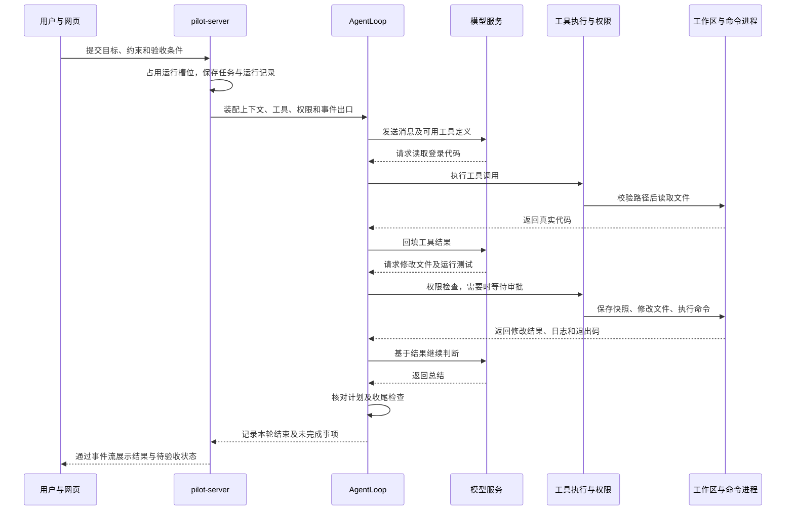
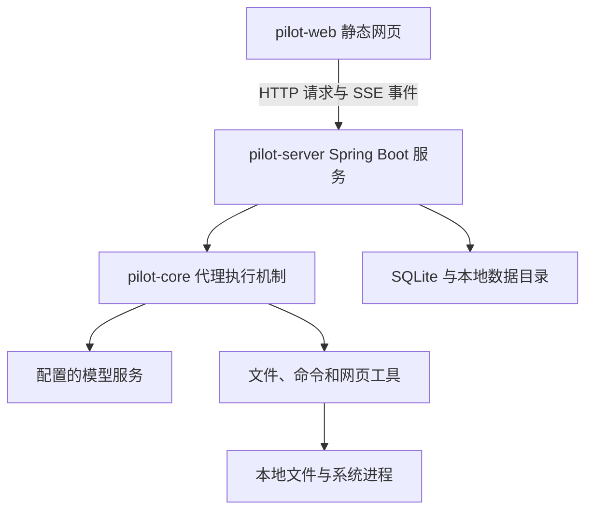

# Pilot 项目模块与技术导览

更新日期 2026-10-28。

本指南面向第一次接触 Coding Agent 的开发者，解释 Pilot 的模块和技术分别解决什么问题，以及它们如何组成一条完整的开发任务执行链。先理解任务如何运行，再沿源码入口深入，比从目录和类名逐个阅读更容易建立整体认识。

Pilot 把用户需求交给大模型分析，再由本地程序检查权限、读取代码、修改文件、执行命令并将结果送回模型。大模型提供下一步建议，Pilot 负责把建议变成受控操作、保存状态和向用户展示结果。两者共同构成编码代理。

本指南对应仓库提交 `14c6816732a61ea6f8f6f4031bd466e533853784` 的实现，重点包括该版本新增的后台命令任务。文中将能力分为“已实现”“已有机制但存在缺口”“讨论中的方案”，避免把开发规划当成现有功能。

## 1 先建立整体认识

### 从聊天模型到编码代理

用户提出“修复登录错误提示，并补测试”时，单次模型回答可以给出代码建议。要真正完成开发工作，还需要程序读取实际项目、让模型基于源码提出工具调用、执行修改、检查测试结果，并决定继续还是结束。

这些额外机制形成了 Agent 的运行环境，也常被称为 harness。Pilot 自己实现了这层运行环境，核心循环没有依赖 Spring AI 或 LangChain 之类的代理框架。

| 概念 | 在 Pilot 中的含义 | 为什么需要区分 |
| --- | --- | --- |
| 模型 Model | 通过 HTTP 调用的外部模型服务，返回文字或工具调用 | 模型服务不会因为收到一句“修改文件”就自动获得本地文件访问能力 |
| 智能体 Agent | 模型、上下文、工具、权限和执行循环的组合 | 它能够根据工具结果持续推进任务 |
| 工具 Tool | 一项后端明确注册的能力，例如读文件或运行命令 | 让模型意图转成可以检查、执行和记录的操作 |
| 项目 Project | 用户在界面中管理的项目记录，可以绑定多个文件夹 | 项目归属与磁盘位置不是同一个字段 |
| 工作区 Workspace | 本次工具操作对应的磁盘根目录 | 文件路径必须按本次会话的工作区解释 |
| 会话 Session | 一个项目中的长期对话，拥有历史和模型记忆 | 一段会话可以跨多次执行，不等于一个运行中的线程 |
| 运行 Run | 一次启动或续跑的执行实例，具有 runId 和结束状态 | 取消、耗时、错误和运行快照需要归属到具体一次执行 |
| 任务目标 Task | 原始目标、约束、验收要求和纠正记录 | 模型记忆被压缩或暂停后，任务要求仍要保留 |
| 计划 Plan | 执行任务时维护的步骤及其完成状态 | 计划可以调整，原始目标不能被计划悄悄替换 |
| 命令任务 Command Task | 一次实际启动的命令和进程，具有 taskId、日志及退出码 | 后台进程可能在模型结束本轮回答后仍继续运行 |

多智能体中还有 `TaskSpec`，它表示派发给某个子 Agent 的子任务。它与上表的会话级任务目标属于不同层次，不能因为都叫“任务”就混用状态。

### 建议阅读顺序

第一次阅读先看第 2 节的完整流程、第 3 节的模块地图，以及第 4 节的技术选择。随后按兴趣阅读执行、权限、长任务和多智能体。第 14 节提供按问题定位源码的路线。

## 2 从一次任务看整个系统

以“修复登录错误提示，补测试，保持 API 兼容”为例。下面是系统的一条可能执行路径，具体读取哪些文件、调用哪些工具由模型决定。

| 步骤 | 发生了什么 | 解决的问题 | 主要参与者 |
| --- | --- | --- | --- |
| 1 | 页面提交内容和任务要求 | 把自然语言输入与结构化约束一起交给后端 | `app.js`、`SessionController` |
| 2 | 判断当前会话是否正在运行 | 连续点击发送时，避免并发启动两次执行 | `RunRegistry`、`AgentRunService` |
| 3 | 保存目标、准备历史、加载项目规则和工具 | 模型需要知道真实任务、可用能力和项目约定 | `TaskControlService`、`PromptLibrary`、`WorkspaceToolFactory` |
| 4 | 将消息及工具定义发送到模型 | 让模型选择下一步，而不是在 Java 中写死整个业务流程 | `AgentLoop`、`ModelClient` |
| 5 | 校验并执行工具，必要时等用户审批 | 防止模型给出的操作未经授权直接执行 | `ToolExecutor`、`PermissionGate`、`ApprovalBroker` |
| 6 | 将工具结果作为消息返回模型 | 让下一步基于实际源码、错误或测试结果 | `Message.tool`、`AgentLoop` |
| 7 | 持续修改和验证 | 一次模型调用通常不足以完成开发任务 | `AgentLoop`、文件工具、命令工具 |
| 8 | 保存事件、记忆、快照和日志 | 页面重连、续跑和排查问题需要这些记录 | 会话仓储、快照服务、命令任务管理器 |
| 9 | 模型尝试结束时检查计划和验证记录 | 减少过早交差和只描述方案却没执行的情况 | `CompletionGate`、计划仓储 |
| 10 | 有明确验收条件时等待用户核对 | 模型本轮结束与用户认可完成需要分别表达 | `TaskControlService`、任务卡 |

如果测试失败，工具结果会回传给模型，模型可以继续修复；如果权限被拒绝，也会返回拒绝原因。如果发生模型服务错误、取消或达到步数上限，运行会以相应状态结束并保留可用记录。

入口源码：[SessionController](pilot-server/src/main/java/com/pilot/server/session/SessionController.java)、[AgentRunService](pilot-server/src/main/java/com/pilot/server/agent/AgentRunService.java)、[AgentLoop](pilot-core/src/main/java/com/pilot/core/loop/AgentLoop.java)。

## 3 物理模块和功能模块

### 三个 Maven 模块

| 模块 | 负责什么 | 为什么分开 | 当前实现方式 |
| --- | --- | --- | --- |
| `pilot-core` | 执行循环、消息和模型协议、工具、权限、压缩、多智能体领域结构 | 核心行为可以脱离 Web 服务独立测试和复用 | 纯 Java；使用 Jackson、SLF4J；不依赖 Spring |
| `pilot-server` | HTTP 接口、对象装配、会话调度、持久化、审批入口、工作区和运行时管理 | 把核心机制接入实际应用和操作环境 | Spring Boot、Spring Web MVC、JDBC、本地文件 |
| `pilot-web` | 项目导航、聊天、进度、审批、变更、任务和命令面板 | 用户需要看见执行过程并随时介入 | HTML、CSS、原生 JavaScript、浏览器 Fetch 和 EventSource |

模块边界与最终发布方式需要分别理解。`pilot-web` 保存网页资源，但这些资源会被 `pilot-server/pom.xml` 收入服务端包，所以普通启动只需要一个服务端进程，浏览器从该服务获取页面，无需另开前端开发服务器。

### 按业务问题看功能模块

| 功能模块 | 它在解决什么问题 | 当前主要机制 | 重要边界 |
| --- | --- | --- | --- |
| 项目与会话 | 多个仓库和聊天如何归档、定位和继续 | Project、Session、仓储和工作区绑定 | 不会为每个会话自动创建独立 Git 工作区 |
| 执行调度 | 谁正在跑，什么时候启动下一件事 | RunRegistry、运行线程池、排队消息 | 当前运行索引在进程内，不是分布式调度 |
| Agent 主循环 | 模型如何根据工具反馈反复推进 | AgentLoop、多步消息、停止条件 | 模型能力仍决定任务质量 |
| 模型接入 | 如何切换兼容的模型服务 | ModelClient、HTTP、JSON、配置代理 | 协议兼容不保证各模型行为完全一致 |
| 提示词和项目规则 | 模型应该按什么方式工作 | Markdown 模板、仓库概览和根目录约定 | 提示词不能代替后端权限检查 |
| 工具执行 | 自然语言建议如何变成实际动作 | 工具注册表、参数、执行器、结果回填 | 只有注册并实现的能力可执行 |
| 权限和审批 | 哪些动作允许直接做，哪些要问用户 | 权限档位、工具属性、审批 Future | 不是系统级进程沙箱 |
| 文件和路径 | 模型如何找到并准确修改代码 | PathValidator、按片段读取、唯一匹配替换 | 命令进程内部读写不经过这些文件工具 |
| 命令管理 | 长测试和开发服务如何持续运行 | CommandTaskManager、状态、日志、进程树管理 | 不等于对进程访问范围的安全隔离 |
| 长任务控制 | 如何排队、纠正、暂停和保留目标 | 持久队列、纠正输入、任务卡与计划 | 暂停不会回滚已经产生的副作用 |
| 上下文管理 | 会话变长后如何继续向模型提供信息 | 裁减工具输出、摘要、预算和记忆持久化 | 摘要会损失细节，重要代码需要复读 |
| 事件与界面 | 用户如何实时知道发生了什么 | 事件信封、SSE、游标回放与前端去重 | 事件流断线不代表后端任务停止 |
| 变更与检查点 | 如何查看修改并有条件回退 | Git diff、写前快照、内容指纹、对话检查点 | 不覆盖所有命令和其他进程的文件副作用 |
| 多子智能体 | 如何分担独立调研和多任务实施 | 独立上下文、DAG、diff 提案、验证和仲裁 | 已有机制，尚有权限、文件视图和恢复缺口 |
| 搜索和附件 | 如何给模型补充代码之外的信息 | SearXNG、网页读取、文本和图片附件 | 网页是外部资料，图片理解依赖模型能力 |
| 观测与维护 | 如何判断失败原因及控制数据积累 | trace、指标、保留策略和启动恢复 | 指标有进程内范围，摘要日志不是完整回放 |

## 4 关键技术为什么出现在这里

| 技术 | 本项目用它解决的问题 | 在哪里出现 | 它不自动解决什么 |
| --- | --- | --- | --- |
| Java 与 JDK 25 | 实现代理执行、文件、网络和进程管理；项目编译和启动要求统一 | 根 `pom.xml`、启动脚本、Java 源码 | 不会因为使用 Java 就自动具备进程沙箱 |
| Maven 多模块与 Wrapper | 构建依赖顺序一致，开发者不必单独配置同版本 Maven | 根及各模块 `pom.xml`、`mvnw`、`mvnw.cmd` | 不负责替模型验证其生成代码的业务正确性 |
| Spring Boot 4 与 Web MVC | 接收 API 请求、托管静态页面、装配服务对象和管理生命周期 | `pilot-server` | 不替代 AgentLoop 的执行策略 |
| JDK HttpClient | 连接模型服务、搜索服务和网页 | 模型客户端及 Web 工具 | 不提供业务级模型任务成功保证 |
| Jackson | Java 对象与 JSON 请求、响应、事件和本地记录之间转换 | 模型、仓储、配置和命令元数据 | JSON 格式合法不代表内容可信 |
| 工具定义和 JSON Schema | 告诉模型工具名字、参数与用途 | `Tool.parameters`、`ToolDefinition` | 不能代替工具内部的参数和权限验证 |
| SQLite 与 JDBC | 单机保存项目、会话、事件、消息、计划和配置 | `store` 包 | 本地数据库不能自动恢复已经失去所有权的系统进程 |
| WAL 与事务 | 缓解读写竞争，并一起保存有关联的数据库变更 | `SqliteStore`、JDBC 仓储 | 不能把数据库与磁盘上多个文件变成同一个原子事务 |
| SSE 与 EventSource | 后端向浏览器持续推送状态、文字、工具和审批事件 | SessionController、app.js | 浏览器断线恢复仍需事件存储、游标和去重 |
| 线程池与 CompletableFuture | HTTP 接口及时返回，后台执行任务，等待异步审批或子任务 | AgentRunService、ApprovalBroker、MultiAgentService | 并发不等于工作区隔离 |
| 虚拟线程 | 以较低线程管理开销处理命令输出和监控等待 | CommandTaskManager | 不限制子进程的文件、网络或 CPU 权限 |
| ProcessBuilder 与 ProcessHandle | 启动工具命令、读取输出、追踪和停止相关进程 | RunCommandTool、CommandTaskManager | 指定工作目录不能阻止进程访问其他目录 |
| Git 与 unified diff | 查看变更、管理分支、表达代码提案和创建验证副本 | ChangeService、multi 包、BranchController | 普通会话不会因此自动拥有独立 checkout |
| SHA-256 内容指纹 | 判断准备回退或接受的文件是否已被其他修改改变 | RunSnapshotService、DiffSandbox、SandboxStore | 哈希比对不是进程隔离，也不能独自解决所有并发竞争 |
| JSONL 与 JSON 文件 | 追加工具摘要、保存命令元数据、任务要求、快照和审计副本 | `.pilot/` 下的不同目录 | 审计副本不代表已有完整恢复流程 |
| SearXNG 与 Python 虚拟环境 | 提供可配置的本地搜索服务，隔开它的 Python 依赖 | LocalSearchRuntime | 不负责隔离 Agent 启动的任意命令 |
| JUnit 与 Node 内置测试器 | 验证核心、接口和前端纯逻辑的确定性行为 | Java 与 JavaScript 测试目录 | 不能从组件测试数量推导真实模型成功率 |

版本以构建文件和运行时代码为准。Node 主要用于前端逻辑测试和被代理项目的工具链，Python 主要用于本地搜索等辅助能力；Pilot 的服务端仍是 Java 程序。

## 5 模型执行和工具调用如何配合

### AgentLoop 负责反复推进

**要解决的问题：**开发任务不是一次请求一次回答，模型需要读代码、见到结果后修改方案，再决定是否继续。

AgentLoop 每步整理消息并请求模型。模型可以返回文字，也可以提出一个或多个工具调用。工具调用经过 ToolExecutor 执行后，结果作为工具消息加入对话，下一步模型就能看到成功、失败、拒绝或测试输出。

循环还会处理取消、当前任务的纠正输入、重复工具调用、最大步数、未完成计划和收尾提醒。连续请求同样的工具及参数达到阈值时中断，防止无意义重复。模型失败按类别处理：断网、超时、连接中途断开、408、429、5xx 都一直重试，节奏约 3 秒一次，只有用户取消才停，避免一次抖动或一段服务端故障让任务判死；只有鉴权或权限不足、余额或额度耗尽、模型不支持、请求或响应结构非法这类重试也不会变好的错误才立刻失败并报告原因。

AgentLoop 负责“接下来还要不要继续”，不是“这些业务代码是否已经正确”的最终裁判。当前收尾门有提醒次数上限，不能把它当成不可绕过的发布验证门。

源码：[AgentLoop](pilot-core/src/main/java/com/pilot/core/loop/AgentLoop.java)、[ModelRetryPolicy](pilot-core/src/main/java/com/pilot/core/loop/ModelRetryPolicy.java)、[CompletionGate](pilot-core/src/main/java/com/pilot/core/loop/CompletionGate.java)。

### ModelClient 隔开执行逻辑和模型协议

**要解决的问题：**不能让主循环到处关心 HTTP 地址、JSON 字段和模型服务配置。

`ModelClient` 定义主循环需要的接口，`OpenAiCompatibleModelClient` 把消息和工具定义转成兼容 Chat Completions 的请求，并把文字及 `tool_calls` 转回项目对象。实现同时包含普通响应和流式响应；流式调用会拼接工具参数片段并将文字预览向上交付。

`ModelClientProvider` 根据当前模型配置创建或复用实际客户端。用户在界面修改模型或端点后，后续请求使用新配置，不需要把整个主循环重写。

兼容这里指请求响应的接口形状，不要求模型一定来自某一家。实际能否正确调用工具、理解图片和完成开发任务，仍要针对所选服务测试。当前服务端没有独立的无密钥 Mock Agent 实现；界面可以先配置，真实任务需要可用的模型服务及该服务要求的鉴权。

源码：[ModelClient](pilot-core/src/main/java/com/pilot/core/model/ModelClient.java)、[OpenAiCompatibleModelClient](pilot-core/src/main/java/com/pilot/core/model/OpenAiCompatibleModelClient.java)、[ModelClientProvider](pilot-server/src/main/java/com/pilot/server/model/ModelClientProvider.java)、[ModelSettings](pilot-server/src/main/java/com/pilot/server/model/ModelSettings.java)。

### PromptLibrary 提供工作规则

**要解决的问题：**相同的工具能力，如果没有任务规则和项目信息，模型仍可能做错方向。

系统提示由身份、流程、工具策略、多智能体规则和输出要求等 Markdown 模板组成。运行时再注入仓库顶层结构、Git 状态、构建线索和项目约定。当前项目约定只读取工作区根目录的 `PILOT.md`、`AGENTS.md`、`CLAUDE.md` 中第一个存在且有效的文件，没有完整的逐层目录规则体系。

提示词可通过外部目录覆盖，减少调试时重新打包的成本。模板使用 `{{name}}` 变量，缺少变量就报错，避免把未渲染的提示词交给模型。

提示词能告诉模型“不要越权”“先运行测试”。真正是否允许执行，还要由工具权限和代码检查决定。

源码：[PromptLibrary](pilot-core/src/main/java/com/pilot/core/prompt/PromptLibrary.java)、[提示词目录](pilot-core/src/main/resources/prompts)、[运行时提示装配](pilot-server/src/main/java/com/pilot/server/agent/AgentRunService.java)。

### ToolRegistry 和 ToolExecutor 执行明确能力

**要解决的问题：**模型给出的工具名和参数，需要映射到具体代码，并统一经过权限、结果和事件处理。

ToolRegistry 是工具目录；ToolExecutor 是单次调用的执行流程。执行器先找工具，再判断允许、拒绝或需要审批；获批后还会在开始执行前检查暂停、取消和纠正信号。工具结果中的已修改路径及检查摘要会交给主循环，用于展示和收尾判断。

| 工具 | 解决的问题 | 结果或副作用 |
| --- | --- | --- |
| `list_dir`、`glob_files`、`search_text`、`read_file` | 查文件、按名字找文件、找调用、按范围读取源码；`read_file` 还能读图片，并对 PDF 抽取文本（扫描件渲染为图片） | 返回所见内容；图片以图片消息交给模型 |
| `edit_file`、`create_file`、`apply_patch` | 精确替换、创建文件，或用一份补丁跨文件修改（含重命名、删除） | 主会话直接写工作区，补丁要么全部生效要么全部不落盘；调度子任务使用另外的沙箱版本 |
| `run_command` | 编译、测试、lint、启动服务或检查 Git；支持 `&& \|\| ; \|` 串联，每一段独立校验 | 查看类命令只读放行，构建与写入类按权限档位审批；启动真实进程 |
| `browser` | 在隔离浏览器里验证本机 Web 应用：快照、点击、输入、上传、截图、控制台与网络记录 | 浏览器握手成功后才对模型声明；点击等本机交互在 AUTO_EDIT 放行，执行任意脚本需审批 |
| `mcp_tools`、`mcp_call` | 按需发现并调用 `.mcp.json` 里配置的 MCP 服务器工具 | 每次请求只带这两个定义；启动服务器需审批，声明 `readOnlyHint` 的工具免审批 |
| `command_status`、`command_logs`、`stop_command` | 跟踪已经启动的长命令 | 查询状态、增量日志或发出终止请求 |
| `update_plan` | 保存步骤和完成状态 | 更新计划并发出事件 |
| `web_search`、`web_fetch` | 搜索资料和读取网页 | 发起网络请求，返回资料 |
| `spawn_agent`、`dispatch_agents` | 把工作交给子 Agent | 启动子运行或多任务调度 |

### 工具能力随运行时声明

`Tool.availability()` 让依赖外部进程的工具声明自己此刻能否使用：`ToolRegistry.definitions()` 与系统提示词只包含可用工具，调用不可用工具会得到带原因的错误，提示模型不要重试。浏览器要等 sidecar 握手并真的启动过一次浏览器才算可用，MCP 要工作区配置了服务器才可用。权限则可以按「这一次调用」判定（`Tool.readOnly(args)`、`LocalInteraction`），所以 `run_command` 里的 `git status` 与 `mvn test`、`browser` 里的快照与点击会得到不同的审批结果。工具产出的图片（截图、PDF 页面、MCP 图片）作为 `ToolResult.images` 返回，循环把它们放进紧随工具结果之后的一条用户图片消息，旧图片只保留最近几条。

工具参数定义帮助模型使用正确形状，后端仍必须校验输入。给模型看不到某个工具可以减少误用，但也应确认其他工具没有绕过相同边界的能力。

源码：[Tool](pilot-core/src/main/java/com/pilot/core/tool/Tool.java)、[ToolRegistry](pilot-core/src/main/java/com/pilot/core/tool/ToolRegistry.java)、[ToolExecutor](pilot-core/src/main/java/com/pilot/core/loop/ToolExecutor.java)、[WorkspaceToolFactory](pilot-server/src/main/java/com/pilot/server/tool/WorkspaceToolFactory.java)。

## 6 权限 文件边界和沙箱分别负责什么

### 权限门决定这一次工具能不能执行

**要解决的问题：**同样一次文件写入，有时用户允许自动执行，有时必须逐次确认。

| 权限模式 | 文件读取 | 文件写入 | 命令 |
| --- | --- | --- | --- |
| READ_ONLY | 放行只读工具 | 拒绝 | 拒绝 |
| ASK | 放行只读工具 | 等待审批 | 等待审批 |
| AUTO_EDIT | 放行只读工具 | 实现 WritesFiles 的文件工具直接执行 | 等待审批 |
| AUTO | 已注册工具范围内放行 | 放行 | 放行 |

判断以工具实际类型和 `readOnly()` 属性为准，不能只看工具名字。`spawn_agent` 已按只读处理：子代理工具表在构造时就被裁剪成父级只读工具，READ_ONLY 会话可以派只读探索；`dispatch_agents` 会产生沙箱改动，仍按写操作走当前档位的审批。

审批请求通过 callId 登记，执行线程等待 CompletableFuture；界面批准或拒绝后完成该等待。超时按拒绝处理。审批当前在内存中，重启后不能把旧请求当成仍已获准。

源码：[PolicyPermissionGate](pilot-core/src/main/java/com/pilot/core/permission/PolicyPermissionGate.java)、[InMemoryApprovalBroker](pilot-core/src/main/java/com/pilot/core/approval/InMemoryApprovalBroker.java)、[ApprovalController](pilot-server/src/main/java/com/pilot/server/permission/ApprovalController.java)。

### PathValidator 决定文件工具可以解析哪个路径

**要解决的问题：**模型给出的 `../`、绝对路径或工作区中的符号链接可能指向其他目录。

PathValidator 把路径规范化，比较工作区真实路径，并检查目标或最近已存在的祖先，减少通过符号链接和新建路径越界的情况。绑定 AgentScope 后，还会按文件白名单过滤文件工具、目录和搜索视图。

编辑工具要求 old_string 唯一匹配，避免“把所有同名代码都替换掉”。主会话编辑前调用快照接口保存原文件，再写入工作区。

这些检查约束经过相应文件工具的操作。进程被启动后，它自己调用操作系统读写文件，并不会回调 PathValidator。因此“设置工作目录”和“检查命令名”都不能让子进程只看见那一个目录。

源码：[PathValidator](pilot-core/src/main/java/com/pilot/core/workspace/PathValidator.java)、[EditFileTool](pilot-core/src/main/java/com/pilot/core/tool/file/EditFileTool.java)、[AgentScope](pilot-core/src/main/java/com/pilot/core/workspace/AgentScope.java)。

### 当前的三种隔离不要混淆

| 隔离层次 | 具体作用 | 当前状态 |
| --- | --- | --- |
| 上下文独立 | 子 Agent 读过的大量内容不直接塞进父模型上下文 | 已实现基本机制 |
| 改动提案隔离 | 子任务文件修改先形成 diff 和目标内容，等接受后写入 | 已实现提案机制，文件视图一致性仍有缺口 |
| 系统进程隔离 | 操作系统限制命令实际能访问的文件、网络、凭据和资源 | 尚未实现完整后端 |

后续可以自研统一执行层，并接入 Windows 原生限制或容器等后端。容器是实现进程边界和固定环境的一种选择，不是 Agent 多轮执行、多任务并行和持久化的前提。第 13 节说明讨论中的方案。

## 7 长任务为什么需要多套生命周期

### 运行服务管理模型执行

**要解决的问题：**网页请求不能一直阻塞到开发任务完成，还要防止同一会话重复启动。

SessionController 接收请求，RunRegistry 占用会话运行槽，AgentRunService 把执行放到线程池并装配本轮工具和事件出口。普通消息在会话已有运行时进入队列，等当前任务满足结束条件后再独立启动。

RunRegistry 还协调回退和切换分支等工作区操作。它不保证多个不同会话自动使用独立文件树，也不属于跨进程的分布式锁。

源码：[AgentRunService](pilot-server/src/main/java/com/pilot/server/agent/AgentRunService.java)、[RunRegistry](pilot-server/src/main/java/com/pilot/server/run/RunRegistry.java)。

### Queue 和 Steer 区分下一件事与当前纠正

| 用户操作 | 例子 | 系统含义 |
| --- | --- | --- |
| 排队消息 | “修完登录后，再补注册页测试” | 当前任务结束后启动新的独立任务 |
| 立即纠正 | “当前只修改登录页，保持 API 不变” | 在接下来的安全步骤边界调整当前任务 |
| 暂停 | “先停一下，我检查一下” | 保留目标、计划、记忆及队列，停止继续推进 |
| 继续当前 | “按原任务接着做” | 使用保存的记忆与任务要求恢复执行 |

纠正请求绑定预期的 runId，避免用户按下按钮时任务已切到下一项而纠正了错误对象。审批期间发生纠正也要重新检查，不能拿着过期方案继续执行。

当前暂停主要在步骤边界生效，已开始的工具会先完成；后台命令有独立任务，应通过命令停止入口管理。暂停不会撤销已经写入的代码。

源码：[QueuedMessageRepository](pilot-server/src/main/java/com/pilot/server/store/QueuedMessageRepository.java)、[AgentLoop 控制信号](pilot-core/src/main/java/com/pilot/core/loop/AgentLoop.java)、[TaskControlController](pilot-server/src/main/java/com/pilot/server/run/TaskControlController.java)。

### 任务卡保存目标 计划记录过程 验收判断结果

**要解决的问题：**长期运行中，模型可能只记得最近一步，或者把“步骤勾完了”当成“用户需求满足了”。

TaskControlService 单独保存原始目标、约束、验收条件、证据和纠正记录。计划由 update_plan 工具更新，两者在续跑时共同提供给模型。纠正方向会取消已有验收勾选，保留旧证据供重新核对。

CompletionGate 会在改了代码却没有成功检查记录时催模型去验证，也会要求对照目标自审；这是有限次数的提醒。显式验收条件则要求用户勾选并提供证据，未通过时任务显示待验收并保留队列。

三种结束应分别判断：模型本轮不再调用工具、计划步骤全部完成、任务通过用户验收。任何一种都不能自动替代另外两种。

源码：[TaskControlService](pilot-server/src/main/java/com/pilot/server/run/TaskControlService.java)、[UpdatePlanTool](pilot-core/src/main/java/com/pilot/core/tool/UpdatePlanTool.java)、[CompletionGate](pilot-core/src/main/java/com/pilot/core/loop/CompletionGate.java)。

### CommandTaskManager 管理真实进程

**要解决的问题：**开发服务器不会主动退出，大型测试可能运行很久。模型应能先得到任务 ID，之后查询结果，而不是把“启动成功”误当“测试成功”。

主会话的 run_command 使用受托管命令构造器：前台命令等待结果，后台命令立即返回 taskId。状态、增量日志和停止分别通过 command_status、command_logs、stop_command 和页面命令面板提供。

管理器持久保存元数据和日志，监控进程及后代，提供并发、日志和保留数量限制。日志 offset 按 Unicode 码点计数，调用方应使用返回的 nextOffset，避免中文或表情导致漏读或重复。命令结束后还会等待输出读取，尽量保存最后一段日志。

RUNNING 和 STOPPING 不能算验证成功；检查摘要需要匹配实际任务的结束状态和退出码。取消、超时、输出超限等状态，即使恰好取得退出码 0，也不算成功验证。

恢复记录不代表恢复进程所有权。重启时，旧 RUNNING 或 STOPPING 命令会标记为 INTERRUPTED，不会按旧 PID 操作进程。当前基于 ProcessHandle 的追踪也无法可靠兜住所有已经脱离父进程的后台程序，这正是原生进程管理和隔离后端后续要加强的部分。

源码：[CommandTaskManager](pilot-core/src/main/java/com/pilot/core/tool/command/CommandTaskManager.java)、[RunCommandTool](pilot-core/src/main/java/com/pilot/core/tool/command/RunCommandTool.java)、[CommandToolSupport](pilot-core/src/main/java/com/pilot/core/tool/command/CommandToolSupport.java)、[CommandTaskController](pilot-server/src/main/java/com/pilot/server/tool/CommandTaskController.java)、[前端命令逻辑](pilot-web/src/main/resources/static/lib/command-tasks.js)。

## 8 记忆 历史和本地存储各保存什么

### 模型记忆与界面历史分开保存

**要解决的问题：**用户要看完整过程，模型却不能每次都接收越来越长的完整历史。

界面历史由事件组成，包括运行开始、工具、审批、计划、失败和完成等。模型记忆由 system、user、assistant 和 tool 消息组成，是下一次请求真正送给模型的内容。两者分别持久化，压缩模型记忆不会自动删除已经保存的界面事件。

ContextBudget 在采样前检查预算，逐步减少旧工具输出、截短超长输出、请求模型生成交接摘要，并在过满时裁减最旧的消息组。token 是模型处理文本的单位；当前按字符估算而非使用具体模型的精确 tokenizer，所以预算是工程近似值。

摘要能减少消息体积，但可能丢细节。因此任务要求独立保存，重要源码应按需重新读取，不能因为摘要里说“测试通过”就替代实际验证证据。

源码：[ContextBudget](pilot-core/src/main/java/com/pilot/core/loop/ContextBudget.java)、[ContextCompactor](pilot-core/src/main/java/com/pilot/core/loop/ContextCompactor.java)、[ConversationRepository](pilot-core/src/main/java/com/pilot/core/session/ConversationRepository.java)。

### SQLite 保存结构化应用记录

默认使用 `.pilot/pilot.db`，通过 JDBC 直接操作。项目、会话、事件、运行、模型和权限设置、模型消息、计划、排队消息分别有对应表或仓储。WAL 让读写并发更实用，busy_timeout 缓解短暂的写入竞争。

测试可以切换到内存仓储，不污染用户数据。存储接口与实现分开，也使核心执行机制不必知道 SQLite 的 SQL 细节。当前采用本地单机取向，没有引入 ORM 或外部数据库服务。

源码：[StoreConfiguration](pilot-server/src/main/java/com/pilot/server/store/StoreConfiguration.java)、[SqliteStore](pilot-server/src/main/java/com/pilot/server/store/SqliteStore.java)、[JDBC 仓储目录](pilot-server/src/main/java/com/pilot/server/store)。

### 本地文件补充保存大内容和运行材料

| 位置 | 主要保存什么 | 用途和边界 |
| --- | --- | --- |
| `.pilot/pilot.db` | 结构化会话、消息、事件、计划、配置等 | 读取历史和恢复应用状态 |
| `.pilot/snapshots/` | 写前文件和运行检查点材料 | 有条件撤销通过快照接口记录的修改 |
| `.pilot/traces/` | 工具参数、结果摘要和耗时等 JSONL | 排查执行过程；不是完整输出或完整模型调用回放 |
| `.pilot/commands/` | 命令 JSON 元数据与追加日志 | 查询长命令状态、结果和输出 |
| `.pilot/attachments/` | 持久化附件 | 避免把大段二进制直接塞入会话记录 |
| `.pilot/multi/` | 多智能体沙箱审计副本和临时验证材料 | 当前审计副本不等于沙箱重启自动恢复 |
| `.pilot/runtime/` | 可管理的 Python、Node 工具链 | 改善环境准备，不提供进程安全边界 |

会话级任务要求也由 TaskControlService 保存在数据目录的独立 JSON 中。具体子路径和覆盖项以配置及实现为准，修改 `PILOT_DATA_DIR` 会改变默认数据根目录。

数据目录可能包含代码、会话、命令输出和模型凭据。模型设置接口使用掩码展示密钥，不代表 SQLite 中保存的凭据已经加密。命令日志脱敏也不等于所有 trace 和存储都自动脱敏。

## 9 事件流如何把后端过程还原到界面

**要解决的问题：**任务可能执行数分钟，用户不能只看到一个一直旋转的等待标志。

后端把过程转换为 SessionEvent，再包成 EventEnvelope。信封包含会话、runId、时间、类型、协议版本和会话内递增序号。SessionService 将事件持久保存并交给订阅者，浏览器使用 EventSource 接收 SSE。

SSE 是服务端向浏览器推送的通道；提交消息、批准工具和停止任务仍使用普通 HTTP API。重连时通过 after 或 Last-Event-ID 获取错过的事件，前端根据 sequence 去重。慢客户端不会无限拖住 Agent；订阅积压后可以断开，再从保存的历史补拉。

模型服务向 Pilot 的文字流与 Pilot 向浏览器的会话事件流属于两条链路。前者是模型协议，后者还要传工具、审批、计划和状态，不能简单转发模型原始数据代替。

界面用原生 JavaScript 管理状态和 DOM，部分纯逻辑放在 `static/lib/` 中，便于用 Node 测试。当前没有 React、Vue 或前端打包构建链；UI 资源随后端发布。

源码：[EventEnvelope](pilot-core/src/main/java/com/pilot/core/event/EventEnvelope.java)、[SessionService](pilot-core/src/main/java/com/pilot/core/session/SessionService.java)、[事件类型](pilot-core/src/main/java/com/pilot/core/event/EventType.java)、[SessionController](pilot-server/src/main/java/com/pilot/server/session/SessionController.java)、[app.js](pilot-web/src/main/resources/static/app.js)、[前端事件处理](pilot-web/src/main/resources/static/lib/events.js)。

## 10 变更 检查点和 Git 分支分别解决什么

| 能力 | 用户的问题 | 当前实现 | 范围 |
| --- | --- | --- | --- |
| 工作区 diff | “现在有哪些文件和行发生变化” | ChangeService 读取 Git 状态及 diff，补充未跟踪文件展示 | 同一工作区可能包含人工或其他会话的修改 |
| 运行 diff | “这一轮主要改了什么” | 使用运行记录和快照等关联具体改动 | 能力受已记录路径和快照范围限制 |
| 代码回退 | “撤销从某条消息开始的文件修改” | 写前快照、当前内容指纹、连续修改衔接校验 | 不覆盖所有命令和外部程序副作用 |
| 对话回退 | “恢复当时模型记忆和计划” | 运行开始前的对话检查点，配合事件裁剪 | 选择仅对话时文件保持当前状态 |
| 对话分支 | “从这里尝试另一种提问方式” | 新建同项目会话并复制所选位置之前的材料 | 分支会话仍共享当前工作区文件 |
| Git 分支 | “保留另一条代码演进路线” | BranchController 在当前仓库创建并切换分支 | 创建分支没有自动复制出另一个工作目录 |

RunSnapshotService 在文件写工具第一次修改某个路径前保存原内容。回退前核对文件是否又被用户改过，并检查快照可用性；冲突时阻止覆盖。单文件快照存在大小上限，链接文件等场景也有保护限制。

只撤代码、只撤对话和一起撤有不同后果。检查点解决本地操作恢复，Git 负责长期版本历史。未来独立子任务工作区和产物应用还需要另外的提交、验证与恢复协议。

源码：[RunSnapshotService](pilot-server/src/main/java/com/pilot/server/workspace/RunSnapshotService.java)、[ChangeService](pilot-server/src/main/java/com/pilot/server/workspace/ChangeService.java)、[CheckpointController](pilot-server/src/main/java/com/pilot/server/session/CheckpointController.java)、[BranchController](pilot-server/src/main/java/com/pilot/server/git/BranchController.java)。

## 11 多子智能体在分担什么工作

### 两个委派入口

**要解决的问题：**跨目录调研可能产生大量中间内容，多项相互独立的工作也可能适合并行处理。

| 入口 | 预期用途 | 当前方式 | 需要注意 |
| --- | --- | --- | --- |
| spawn_agent | 边界清晰、读取多但结论短的独立探索 | 构造另一个 AgentLoop，同步等待后返回摘要；可选择继承父对话 | 构造时冻结并裁剪父工具表（只读、去递归与 Goal 控制）；同步执行会占住父轮次，单轮最多 4 次派生、24 次子请求 |
| dispatch_agents | 多项调研或实现，带范围、风险、依赖和可选多方案 | MultiAgentService 调度子 Agent，文件修改形成沙箱提案 | 命令、依赖传递、沙箱视图和重启恢复仍有缺口 |

触发由模型选择工具，系统提示词提供使用场景，不是按文件数量自动触发。`pilot.multi.enabled` 控制 dispatch_agents 的注册；当前不能因此推断所有子任务入口同时关闭。

### DAG 是带依赖的任务图

例如：T1 设计并实现登录接口，T2 适配页面依赖 T1，T3 补后端测试也依赖 T1，T4 集成验证依赖 T2 和 T3。T1 先运行，T2 和 T3 才有条件并行。

TaskGraph 验证任务编号和依赖，寻找可执行任务；MultiAgentService 在可执行的一批中按线程池容量运行，子任务失败会阻断相关下游。每个子任务有独立上下文、文件和工具范围、风险以及有限重试次数。

当前依赖只完成了执行顺序的一部分控制，上游生成的文件和结论没有完整物化到下游输入。不能把“等 T1 完了再启动 T2”直接等同于“T2 已经看到了 T1 的新接口”。

### diff 沙箱 验证和仲裁

DiffSandbox 保存子任务提交的 unified diff 和目标内容。MergePrecheck 检查重叠修改等冲突；CommandVerificationGate 尝试建立 Git worktree 验证副本，叠加改动后执行构建或测试。用户通过 MultiAgentController 接受或拒绝提案，接受时有原文件指纹检查。

这是代码提案与检查机制。目前它没有给每个 Worker 提供完整可读写的独立文件树：沙箱编辑仍读真实文件，连续修改可能覆盖前次提案，新文件无法正常复读；允许的命令也在真实工作区执行。

其他需要完成的环节包括：有代码改动时跳过验证仍可能算整批通过；接受接口没有完整验证门控；仲裁选择缺少状态恢复；内存沙箱没有自动从审计 JSON 重建。当前的“校验”和“仲裁”已有组件，但不能据此宣称生产交付闭环已经完成。

源码：[SpawnAgentTool](pilot-server/src/main/java/com/pilot/server/multi/SpawnAgentTool.java)、[DispatchAgentsTool](pilot-server/src/main/java/com/pilot/server/multi/DispatchAgentsTool.java)、[MultiAgentService](pilot-server/src/main/java/com/pilot/server/multi/MultiAgentService.java)、[TaskGraph](pilot-core/src/main/java/com/pilot/core/multi/TaskGraph.java)、[SandboxEditFileTool](pilot-core/src/main/java/com/pilot/core/tool/file/SandboxEditFileTool.java)、[CommandVerificationGate](pilot-server/src/main/java/com/pilot/server/multi/CommandVerificationGate.java)、[SandboxStore](pilot-server/src/main/java/com/pilot/server/multi/SandboxStore.java)。

## 12 辅助能力也有各自的问题边界

### 搜索 网页和附件

WebSearchTool 请求 SearXNG 搜索服务，返回资料线索；WebFetchTool 读取已知网页，做响应大小、类型、协议和地址检查，并将内容标记为不可信资料。LocalSearchRuntime 可在本地管理 SearXNG 的源码、Python 虚拟环境和进程。

本地搜索服务本身当前不依赖 Docker；搜索引擎仍可能向外部来源请求结果。本地部署搜索服务不意味着搜索和模型调用都离线。

AttachmentService 将可解码文本内联到消息，图片保存后由模型客户端按图片内容传递，其他二进制保存并提供引用。保存 PDF 或 Office 文件不代表已经内置完整文档解析器；如何进一步读取，要看可用工具和模型能力。

源码：[WebSearchTool](pilot-core/src/main/java/com/pilot/core/tool/WebSearchTool.java)、[WebFetchTool](pilot-core/src/main/java/com/pilot/core/tool/WebFetchTool.java)、[LocalSearchRuntime](pilot-server/src/main/java/com/pilot/server/search/LocalSearchRuntime.java)、[AttachmentService](pilot-server/src/main/java/com/pilot/server/attachment/AttachmentService.java)。

### 工具链准备与配置热更新

BundledRuntime 为 Python 和 Node 准备数据目录中的运行时，并让命令优先找到它们，减少“用户机器缺工具或版本不对”导致的失败。它准备的是可执行工具，不是安全沙箱，也不代表所有项目依赖都已经安装。

ModelSettings 和 PermissionSettings 从保存的设置及默认配置恢复，并提供当前生效值；模型配置代理和权限网关在后续调用读取新配置。构建时和运行时版本问题仍需分开看，例如 core 修改后只单独启动 server 可能读到本机 Maven 仓库里的旧包，启动脚本先安装依赖链就是为减少这个问题。

源码：[BundledRuntime](pilot-server/src/main/java/com/pilot/server/runtime/BundledRuntime.java)、[ModelSettings](pilot-server/src/main/java/com/pilot/server/model/ModelSettings.java)、[PermissionSettings](pilot-server/src/main/java/com/pilot/server/permission/PermissionSettings.java)、[start.sh](start.sh)、[start.cmd](start.cmd)。

### 恢复 日志 指标和数据清理

InterruptedRunRecovery 在服务启动时把上次未正常结束的运行收敛为已中断，避免页面永远显示运行中。恢复任务要求和对话记忆后可以续跑，但原来的线程和网络请求不会原地复活。

JsonlTraceRecorder 记录工具名、参数和结果摘要、权限结果分类以及耗时，适合定位某次调用。RunMetrics 汇总运行状态、事件计数和平均耗时，适合观察整体变化，但目前在内存中，重启后归零。

RetentionService 根据保留天数清理旧的事件、快照和 trace 等材料。保留策略会影响旧检查点和历史材料是否还能使用；不能把“数据库中还有会话”当成“所有早期恢复材料仍存在”。

源码：[InterruptedRunRecovery](pilot-server/src/main/java/com/pilot/server/run/InterruptedRunRecovery.java)、[JsonlTraceRecorder](pilot-core/src/main/java/com/pilot/core/trace/JsonlTraceRecorder.java)、[RunMetrics](pilot-server/src/main/java/com/pilot/server/observability/RunMetrics.java)、[RetentionService](pilot-server/src/main/java/com/pilot/server/maintenance/RetentionService.java)。

## 13 已实现机制和未来执行后端的分界

统一执行层已落地第一版：`com.pilot.core.exec` 定义 `ExecutionBackend` 契约，提供本地后端与容器后端，并由 `ExecutionBackends.select` 按配置选择。容器不可用时不静默降级，`Selection.degraded()` 与 `/api/maintenance/status` 会给出原因。Windows 原生后端（受限令牌、Job Objects、AppContainer）仍未实现。

| 方案或机制 | 解决什么问题 | 当前状态 |
| --- | --- | --- |
| PathValidator、PermissionGate、审批 | 控制经过 Pilot 工具入口的文件和操作 | 已实现 |
| CommandTaskManager | 命令状态、输出、超时、取消和恢复记录 | 已实现；进程追踪有平台与脱离子进程的限制 |
| diff 提案和 Git worktree 验证 | 暂存子任务改动，尝试在副本构建 | 已有机制但存在缺口 |
| 统一执行层 `ExecutionBackend` | 把工作区、策略、进程和系统限制放到统一契约下 | 已实现（本地/容器两种后端） |
| 容器校验执行 | 为编译/测试命令提供独立文件系统、网络与资源上限 | 已接入校验门；`run_command` 仍是宿主进程 |
| Windows 原生后端 | 在 Windows 上限制真实子进程的权限和资源 | 待验证、待实现 |
| 不可变产物清单与依赖传播 | 让上游输出、集成验证和最终接受精确对应 | 已实现（清单历史、差异、依赖失效） |

Windows 原生方案可评估受限令牌、文件 ACL、Job Objects 和 AppContainer。它们的职责不同：Job Objects 主要管理一组进程及资源，文件和网络访问还需要另外的系统机制。原生辅助程序可以随 Pilot 打包，由 Java 调用；编译工具和运行时的兼容性需要实际验证。

容器主要帮助封装执行环境、限制影响范围和管理资源。选择容器后同样需要正确配置目录、网络、身份和权限；不选择容器，也仍然要解决实际进程的这些边界。多智能体的任务依赖、记忆和验收状态则继续由 Pilot 自己负责。

机制说明：[Windows 受限令牌](https://learn.microsoft.com/en-us/windows/win32/secauthz/restricted-tokens)、[Job Objects](https://learn.microsoft.com/en-us/windows/win32/procthread/job-objects)、[AppContainer](https://learn.microsoft.com/en-us/windows/win32/secauthz/appcontainer-isolation)、[Docker 安全机制](https://docs.docker.com/engine/security/)。这些来源解释技术能力，不代表 Pilot 已经完成对应实现。

生产级分阶段工作见[多智能体生产级开发计划](MULTI_AGENT_PRODUCTION_PLAN.md)。其中原始 Linux 隔离运行器优先的排期属于早期假设；原生优先与容器可选的方向需要在执行后端原型后确定，并重新核对工期。

## 14 按问题选择源码阅读路线

### 第一遍阅读五个位置

1. [SessionController](pilot-server/src/main/java/com/pilot/server/session/SessionController.java)：先找 messages 和 events，理解页面输入如何进入、过程如何出来。
2. [AgentRunService](pilot-server/src/main/java/com/pilot/server/agent/AgentRunService.java)：看 execute，理解本轮的历史、模型、工具、权限和事件出口如何装配。
3. [AgentLoop](pilot-core/src/main/java/com/pilot/core/loop/AgentLoop.java)：看循环中模型回答、工具执行、结果回填和结束判断。
4. [ToolExecutor](pilot-core/src/main/java/com/pilot/core/loop/ToolExecutor.java)：看允许、拒绝、审批和真正开始执行前的检查。
5. [EditFileTool](pilot-core/src/main/java/com/pilot/core/tool/file/EditFileTool.java)：选一项具体工具，把路径检查、快照、写入和结果串起来。

先把这五个位置连接起来，再读压缩、命令管理和多智能体，比从所有类的第一行依次阅读更省力。

### 想调整某项能力时改哪里

| 问题或需求 | 先看哪里 | 同时检查什么 |
| --- | --- | --- |
| 模型一直不调用工具 | ModelClient、工具定义、提示词 | 端点是否兼容、返回格式、所选模型实际工具能力 |
| 模型太早说完成 | CompletionGate、计划、TaskControlService | 工具检查摘要是否真实，人工验收是否仍未通过 |
| 新增一个工具 | Tool、ToolRegistry、WorkspaceToolFactory | 权限属性、参数验证、事件、快照或检查摘要、测试 |
| 文件读错或改错 | PathValidator、ReadFileTool、EditFileTool | 工作区绑定、链接、唯一匹配和并发外部修改 |
| 运行中消息去向不对 | SessionController、AgentRunService、QueuedMessageRepository | Queue 与 Steer、runId 是否过期、队列交接 |
| 后台服务停不干净 | CommandTaskManager、RunCommandTool | 进程归属、后代追踪、包装进程、脱离进程和平台差异 |
| 页面重复消息或断线后状态不对 | SessionService、events API、app.js、lib/events.js | 持久序号、游标、去重和活跃运行校准 |
| 长会话忘记要求 | ContextBudget、ContextCompactor、TaskControlService | 摘要保留内容、原始目标注入、重要文件是否复读 |
| 回退覆盖了人工修改或不可用 | RunSnapshotService、CheckpointController | 内容指纹、快照范围、保留策略和工作区互斥 |
| 多 Agent 看不到上游修改 | MultiAgentService、DiffSandbox、工作区工具装配 | 当前没有完整的依赖产物与独立工作区协议 |
| 要加入操作系统级隔离 | `com.pilot.core.exec`（ExecutionBackend、ContainerExecutionBackend） | 系统权限、网络、工具链、路径映射、进程树、故障恢复 |

### 测试各自证明什么

| 测试层次 | 典型位置 | 能证明什么 |
| --- | --- | --- |
| 核心单元测试 | `pilot-core/src/test/java/` | 工具、权限、循环、压缩和领域规则在给定输入下的行为 |
| 服务与 API 测试 | `pilot-server/src/test/java/` | 请求、持久化、队列、恢复、检查点和服务装配的协作 |
| 前端纯逻辑测试 | `pilot-web/src/test/js/` | 事件去重、diff、请求参数、项目和命令状态等纯逻辑 |
| 浏览器流程验证 | 按具体流程执行并记录 | 输入、审批、暂停、重连和变更等可见交互是否正确 |
| 真实模型任务评估 | `evaluation/` 中的规格与结果 | 在冻结项目上能否完成真实开发任务及其成本和失败方式 |

运行 Java 测试用根目录 `bash mvnw test`，Windows 用 `mvnw.cmd test`。前端纯逻辑可在 pilot-web 下执行 `node --test src/test/js/*.test.js`。测试需要的本机端口、进程和运行时环境应与产品需求一起准备。

当前 evaluation 目录包含测试映射和评估记录，它明确区分自动化测试与尚待开展的真实模型评估。开发时应把新增机制对应到失败用例和实际任务，不把单测全绿写成已经达到生产级任务成功率。

## 15 后续怎样维护这些文档

| 文档 | 用途 | 什么时候更新 |
| --- | --- | --- |
| [README](README.md) | 启动、常用入口、配置和当前限制 | 安装方式、命令、接口或用户可见行为变化 |
| 本指南 | 模块职责、技术作用、完整流程和能力边界 | 新增或替换模块、状态归属或实现技术 |
| [产品计划](PRODUCT_PLAN.md) | 产品定位、用户场景和总体路线 | 产品范围和阶段目标改变 |
| [多智能体生产级开发计划](MULTI_AGENT_PRODUCTION_PLAN.md) | 缺口、候选架构、工单和发布门槛 | 技术选型确认、工单实施或验收标准改变 |
| [评估任务](evaluation/TASKS.md)与[评估报告](evaluation/REPORT.md) | 如何测试、实际执行结果和覆盖缺口 | 新增任务、冻结评估基线或完成一轮实测 |

新增模块时至少回答四个问题：它解决了什么具体问题，为什么放在这一层，输入和输出归谁所有，失败或重启后怎么办。说明已实现能力时给源码入口；说明未来能力时标明待验证，避免后来的人从规划中推断出不存在的实现。

## 16 可靠性、隔离与可观测性的实现位置

这一节记录本轮补齐的工程能力与仍然存在的边界，避免把「有代码」误读成「已经生产可用」。

| 能力 | 源码入口 | 关键约束 |
| --- | --- | --- |
| 可恢复调度状态 | `RunCheckpoint`、`RunCheckpointRepository`、`JdbcRunCheckpointRepository`、`RunStateTracker` | 事件回答「发生过什么」，检查点回答「下一步做什么」；每次工具开始/结束、审批、重试都推进检查点 |
| 租约与安全接管 | `RunStateTracker.begin/claimLease/heartbeat/recoverAfterRestart` | 同一会话同一时刻只允许一个实例推进；租约过期或释放后才能接管；启动恢复只收敛为中断，不自动重放工具 |
| 工具调用幂等 | `ToolCallJournal`、`JdbcToolCallJournal`、`ToolExecutor.withJournal` | 只对写文件重放，且要求文件现状与写入后指纹一致；命令重跑是预期行为，永不重放 |
| 执行隔离 | `com.pilot.core.exec` 下的 `ExecutionBackend`、`LocalExecutionBackend`、`ContainerExecutionBackend`、`ExecutionBackends` | 容器请求不支持静默降级；`run_command` 仍走宿主进程，容器只覆盖校验命令 |
| 产物版本 | `ArtifactManifest`、`ArtifactFile`、`InputBundle`、`SandboxStore.manifestHistory/manifestDiff/linkDependency` | 清单只读、按修订递增；候选指纹包含依赖指纹；上游变化使下游校验失效 |
| 校验与完成声明绑定 | `ValidationLedger`、`ValidationEvidence`、`WorkspaceFingerprint`、`/api/sessions/{id}/validation` | 证据绑定候选指纹、命令、环境和运行；产物变化后旧证据不再支撑完成 |
| 重试治理 | `RetryBudget`、`AgentLoop.withRetryBudget`、`RunRetrying` | 指数退避 + 抖动 + 次数/时长预算 + 熔断；余额与鉴权错误仍立即失败 |
| 模型兼容契约 | `pilot-core/src/test/resources/model-contract/`、`ModelContractTest` | 脱敏样本覆盖鉴权、余额、限流、网关错误、流式中断、结构异常 |
| 诊断与脱敏 | `TaskDiagnosticsService`、`Redaction`、`/api/sessions/{id}/diagnostics` | 只读汇总；密钥类文本在输出前脱敏；存储降级会显示原因 |
| 数据生命周期 | `BackupService`、`RetentionService`、`StorageHealth`、`/api/maintenance/*` | 备份用 `VACUUM INTO`；恢复只能停服务后整体覆盖；写盘失败降级但继续任务 |
| 远程访问边界 | `SecurityProperties`、`AccessControl`、`RemoteAccessFilter`、`AccessAudit` | 默认仅回环；令牌模式需显式配置；来源校验与限流；拒绝写审计 |
| 跨平台与窄屏 | `.github/workflows/ci.yml`、`CrossPlatformPathTest`、`pilot-web/src/test/viewport/check-viewports.mjs` | 三平台跑完整测试；固定视口检查横向溢出与关键控件可见性 |
| 真实模型评估 | `evaluation/harness/tasks.json`、`runner.mjs`、`metrics.mjs` | 外部验收命令未执行就不算成功；记录模型/提示词/工具版本以便横向比较 |

仍然明确没有做到的：

1. 多实例集群调度：租约依赖共享 SQLite，跨机器部署没有协调层。
2. Windows 原生沙箱与 `run_command` 的容器化：需要路径映射、工具链镜像、停止语义与后代进程归属。
3. 远程访问的多用户与权限模型：只有单一共享令牌。
4. 真实任务集的 fixture 仓库与实测数据：harness 已可运行，但 fixtures 需要按任务补充后才能给出能力结论。
