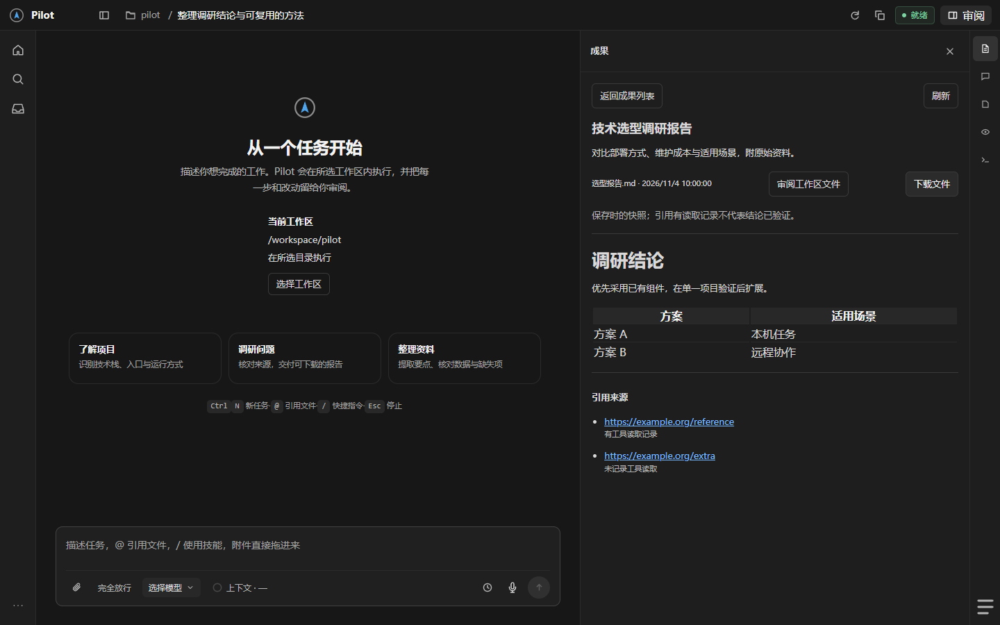
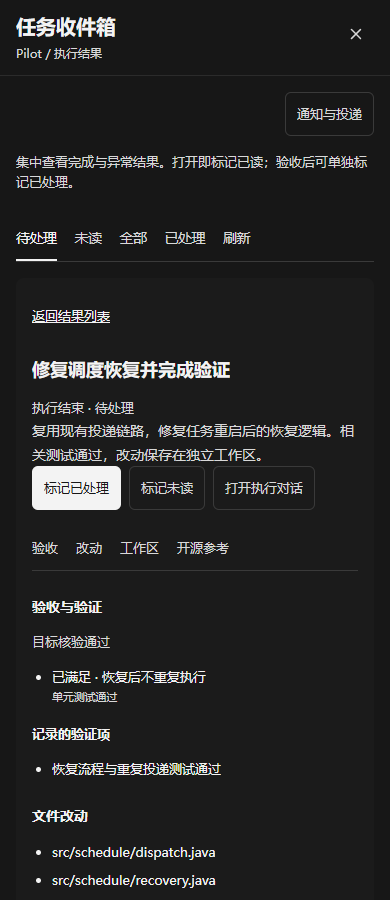
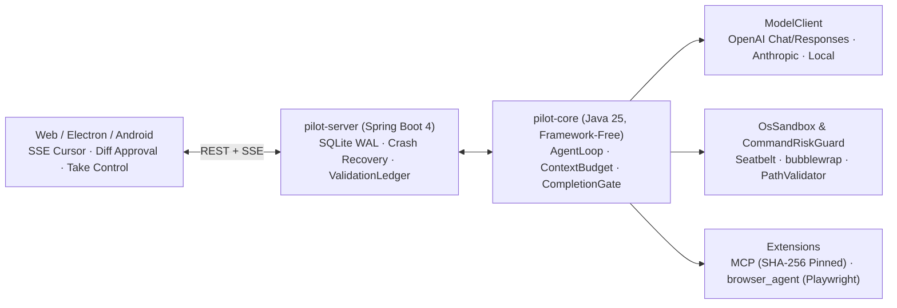

<div align="center">

# Pilot

**A Local-First, Verifiable Coding & Task Execution Agent**

Read repositories, execute tools inside OS-level sandboxes, automate browsers with live human takeover, and deliver cryptographically fingerprinted completion bundles—all running locally on your machine.

<p>
  <a href="https://github.com/zzl-qz/Pilot/actions/workflows/ci.yml"></a>
  
  
  
  
  
</p>

<p>
  <strong>English</strong> · <a href="README.zh-CN.md">简体中文</a> ·
  <a href="docs-public/getting-started.md">Quick Start</a> ·
  <a href="docs-public/architecture.md">Architecture</a> ·
  <a href="docs-public/benchmarks.md">Benchmarks</a> ·
  <a href="docs-public/security.md">Security</a>
</p>

</div>

---

> **Development Preview**: Pilot is built for supervised local engineering and verification. macOS (**Seatbelt**) and Linux (**bubblewrap**) enable OS-level filesystem sandboxing for main-session commands by default (Windows supports an optional restricted-token runner), but local sandboxes are not equivalent to multi-tenant VM isolation. See [Security & Privacy](docs-public/security.md) and [Scope & Boundaries](docs-public/scope.md).

## Showcase

<p align="center">
  
</p>

<p align="center">
  
  
</p>

<details>
<summary>Mobile responsive views (Dark & Light)</summary>
<p align="center">
  
  
</p>
</details>

<sub>*UI screenshots are generated from Pilot's Playwright regression suite using mock API fixtures and sample workspaces; they illustrate the real React workbench rather than live model output.*</sub>

---

## Why Pilot?

Most local coding agents stop at *"Done!"*—leaving you to guess which files changed, whether tests actually ran after the last edit, or what happens if the server crashes mid-run. Pilot embeds **verification, isolation, and crash recovery directly into the runtime**:

- **Verifiable Execution Harness**: Pre-flight code localization (`PreFlightLocator` + repository briefs), message-level read-only `plan` vs. `act` modes (`Shift+Tab`), 4-tier prefix-cache-preserving context compaction, and runtime-native `CompletionGate` / `LintGate` checks backed by `pilot.policy.yaml`. Modifying any file after verification automatically marks old evidence `STALE`.
- **Durable Event-Sourced Runtime**: Built on **Java 25 + Spring Boot 4 + SQLite (WAL)**. Every state change persists as a monotonic event before broadcast, enabling lossless SSE cursor replay on disconnect, `SIGKILL` crash takeover without replaying completed tool side effects (**8/8** recovery assertions passing), and tiered 429/5xx backoff with automatic backup model failover.
- **Defense-in-Depth Local Safety**: Platform-native **Seatbelt (macOS)** and **bubblewrap (Linux)** command sandboxes (`.git/config` & `hooks` locked read-only, optional outbound network block), `PathValidator` symlink escape prevention, non-bypassable `CommandRiskGuard` redlines even under `AUTO`, unified `SecretScrubber` credential redaction, and **SHA-256 MCP config + tool-definition pinning** against rug-pull attacks.
- **Isolated Browser Subagent & Live Human Takeover**: Dedicated Playwright `browser_agent` (isolated from workspace files/shell and `evaluate`) with same-origin nested `iframe`/Shadow DOM traversal, occlusion checks, hard-blocked payment pages with user `handoff`, instant **Take Control / Stop** preemption, and zero-dependency `.replay.json` session recordings with frame-level bounding-box feedback.
- **Multi-Protocol & Multi-Surface**: Native SSE streaming and Prompt Caching for **OpenAI Chat Completions**, **OpenAI Responses**, and **Anthropic Messages**—plus keyless local models (Ollama, LM Studio, llama.cpp, vLLM). Accessible via **Web**, **Electron desktop** (with self-contained `jlink` packaging), and optional **Android** remote approval client.

---

## Architecture



See [docs-public/architecture.md](docs-public/architecture.md) for sequence diagrams and module invariants.

---

## Benchmarks & Verification

Pilot is evaluated on an official stratified 40-task split of **[ByteDance-Seed/Multi-SWE-bench-flash](https://huggingface.co/datasets/ByteDance-Seed/Multi-SWE-bench-flash)** (20 Java + 20 TypeScript across 7 real open-source repositories; **40/40 golden-patch preflight verified**). Every run uses an ephemeral sanitized Docker container (all `/home/*.patch` / `*run.sh` stripped, git history collapsed to a single `baseline` commit, **0/104 anti-cheat violations**) and upstream `multi_swe_bench` hidden-test grading (`--workers 1`).

**Controlled Vertical A/B** — identical model (`gpt-6.1-sol`) and endpoint, strictly interleaved (`--interleave`) comparing pre-optimization baseline `v0-0caa2257` vs. current `v1-9b862d35`:

| Metric | `v0-0caa2257` (Before) | `v1-9b862d35` (After) | Delta |
| --- | ---: | ---: | ---: |
| **Official `pass@1`** (95% Wilson CI) | **50.0%** (20/40) | **60.0%** (24/40) | **+10.0 pp** |
| **Strict `COMPLETED & Pass`** (95% CI) | **45.0%** (18/40) | **57.5%** (23/40) | **+12.5 pp** |
| — **Java Subset** (20 tasks: Jackson, Gson, Jib) | 50.0% (10/20) | **75.0%** (15/20) | **+25.0 pp (5W / 0L)** |
| **Avg Requests Before First Edit** | 9.87 | **5.85** | **-40.7%** |
| **Avg Model Requests / Task** | 29.0 | **23.1** | **-20.3%** |
| **Repeat Consistency** (`v1`, 12 tasks × `k=3`) | — | **`avg@3 55.6%` / `pass^3 50.0%`** | **11/12 zero-variance** |
| **Crash & SSE Recovery Smoke** (0-token) | — | **8 / 8 assertions passed** | Zero side-effect replay |

> **Transparent Scope**: Conducted via proxy endpoint (`gpt-6.1-sol`); full-set exact McNemar `p = 0.289` (official) / `0.180` (strict), Java 20-task `p = 0.0625` (5W/0L). Results demonstrate controlled paired harness delta rather than cross-model leaderboard claims. Full methodology, per-task matrix, and reproduction scripts live in [docs-public/benchmarks.md](docs-public/benchmarks.md) and [evaluation/multi-swe-bench/](evaluation/multi-swe-bench/README.md).

---

## Quick Start

### 1. Clone & Launch

```sh
git clone https://github.com/zzl-qz/Pilot.git
cd Pilot
```

**macOS / Linux:**

```sh
bash start.sh
```

**Windows (PowerShell / CMD):**

```powershell
.\start.cmd
```

First launch automatically provisions Java 25, Node.js 22, and desktop dependencies into Pilot's private cache, builds and verifies the server, and opens `http://localhost:9999` (plus the Electron desktop shell when available).

### 2. Configure a Model & Try Safely

Switch permission mode to `ASK` or `READ_ONLY` (or toggle `plan` mode via `Shift+Tab`) inside a disposable repository first. You can explore the UI with **Mock mode** (no API key), connect keyless local models (**Ollama / LM Studio / vLLM**), or pass a live endpoint:

```sh
PILOT_MODEL_API_KEY="your-api-key" \
PILOT_MODEL_ENDPOINT="https://api.openai.com/v1/chat/completions" \
PILOT_MODEL_MODEL="gpt-4o-mini" \
PILOT_WORKSPACE="/path/to/test-repo" \
bash start.sh
```

See [Getting Started](docs-public/getting-started.md) for Windows PowerShell commands, custom ports, and multi-preset failover setup.

---

## Documentation

| Category | Guides |
| --- | --- |
| **Start & Usage** | [Getting Started](docs-public/getting-started.md) · [User & Configuration Guide](docs-public/user-guide.md) · [Documentation Index](docs-public/README.md) |
| **Architecture & Verification** | [Architecture](docs-public/architecture.md) · [Benchmarks](docs-public/benchmarks.md) · [Verification Approach](docs-public/verification-approach.md) · [Completion Bundles & Policies](docs-public/completion-capsule.md) |
| **Security & Trust** | [Security & Privacy](docs-public/security.md) · [MCP Trust Model](docs-public/design-mcp-trust.md) · [Scope & Boundaries](docs-public/scope.md) · [Security Policy](SECURITY.md) |
| **Extensibility & Clients** | [Plugin Contracts](docs-public/plugin-contracts.md) · [Desktop & Release Packaging](pilot-desktop/RELEASE_PACKAGING.md) · [Android Companion](pilot-mobile/README.md) |
| **Engineering & Contributing** | [Technical Guide (zh-CN)](PROJECT_TECHNICAL_GUIDE.md) · [Contributing](CONTRIBUTING.md) · [Multi-SWE-bench Suite](evaluation/multi-swe-bench/README.md) |

---

## Repository Structure

```text
pilot-core/       Framework-free agent loop, model protocols, tools, sandboxes & trust policies
pilot-server/     Spring Boot 4 runtime, SQLite WAL event store, recovery & verification ledger
pilot-web/        React + TypeScript workbench frontend
pilot-desktop/    Electron desktop host & cross-platform jlink self-contained packaging
pilot-mobile/     Optional Android remote approval client & P2P/relay bridge
docs-public/      Bilingual public documentation (English primary + zh-CN/)
evaluation/       Automated harnesses, Multi-SWE-bench suite & archived reports
site/             Static GitHub Pages landing site (English + zh-CN)
```

## Development & Verification

Full cross-platform CI runs on Windows, macOS, and Linux ([ci.yml](.github/workflows/ci.yml)). Run server verification locally:

```sh
sh mvnw -B -ntp verify          # macOS / Linux
.\mvnw.cmd -B -ntp verify        # Windows
node scripts/check-doc-links.mjs # Verify all repository documentation links
```

## License

Pilot's original source code and documentation are licensed under the [Apache License 2.0](LICENSE). Third-party components retain their respective licenses.
