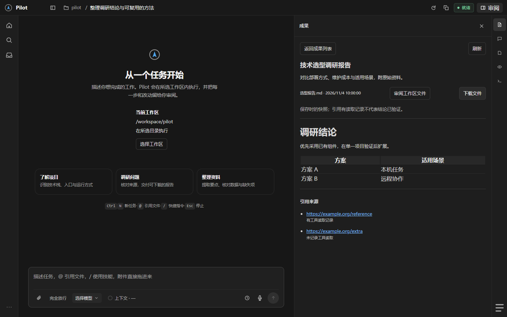
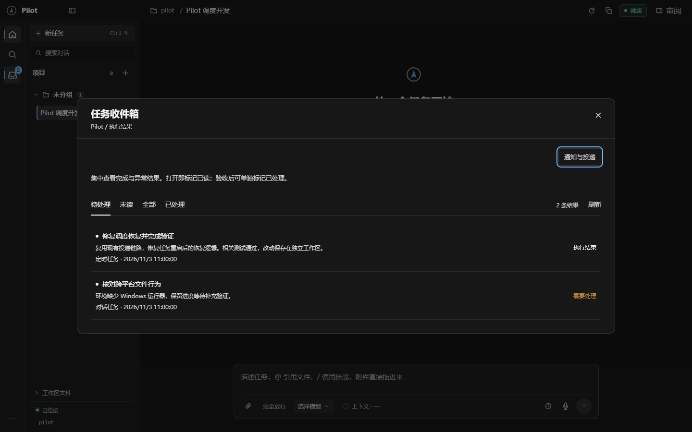
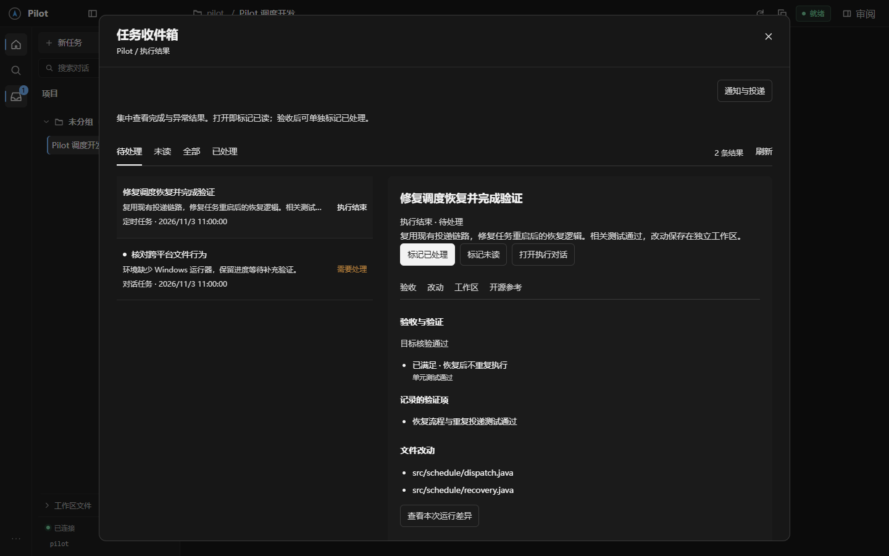
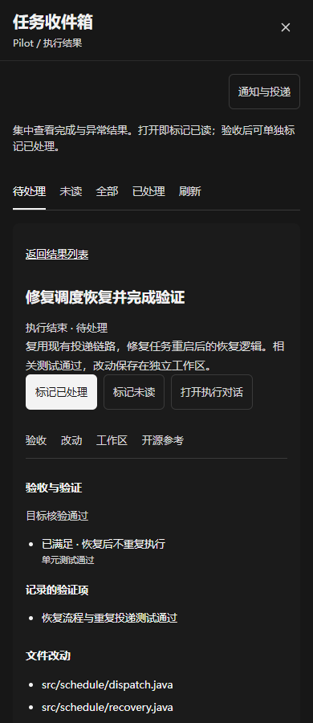
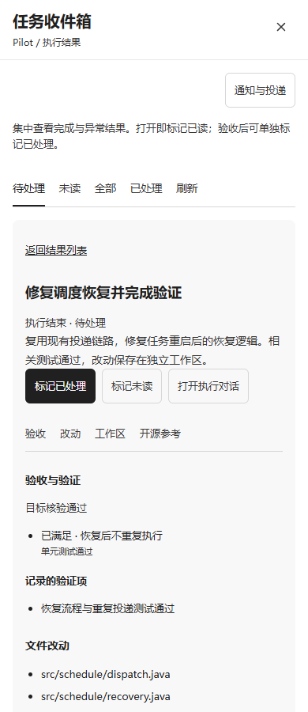

# Pilot

<p align="center"><strong>在本机工作区中运行的任务执行 Agent</strong><br>阅读项目、执行文件与工具任务，并把改动、验证和结果留给你审阅。</p>

<p align="center">
  <a href="https://github.com/zzl-qz/Pilot/actions/workflows/ci.yml"></a>
  
  
  
</p>

Pilot 提供 Web 与 Electron 工作台，并附带 Android 远程客户端。模型通过 OpenAI Chat Completions 兼容端点接入；任务数据、工作区和执行环境由你自己的 Pilot 实例管理。

> **当前阶段：开发预览。** 功能与平台覆盖仍在验证中，不建议用于无人监督的生产工作。Pilot 的权限策略不是操作系统级沙箱。仓库目前也没有 `LICENSE` 文件，因此尚未授予开源使用、修改或再分发权利。

## 界面

<p align="center">
  
</p>

<p align="center">
  
  
</p>

<p align="center">
  
  
</p>

截图由项目的 Playwright UI 回归场景生成，使用模拟 API 响应和示例任务数据；展示的是实际 React 工作台界面，不代表真实模型运行或线上任务记录。

## 功能

- **可审阅的执行过程**：流式显示消息和工具活动；呈现待审批操作、计划、文件差异、验证状态与执行结果。
- **本机工作区工具**：读取、搜索和修改文件，运行命令，查看 Git 变更；支持检查点与受校验的回退。
- **可交付的文件任务**：处理 Office/PDF 文件、保存成果快照，并在工作台预览和核对。
- **可选的远程工作流**：Electron 桌面壳和 Android 客户端复用本机服务；远程连接不会因安装而自动开放。
- **可替换模型端点**：使用兼容 Chat Completions 的服务；没有模型密钥时可用 Mock 模式体验界面流程。

这些是项目当前实现的能力范围，不表示模型每次都能正确完成任务。详细边界见[安全与隐私](docs-public/security.md)和[功能与配置参考](docs-public/user-guide.md)。

## 快速开始

克隆仓库后，在仓库根目录按操作系统启动：

```sh
git clone https://github.com/zzl-qz/Pilot.git
cd Pilot
bash start.sh
```

Windows PowerShell 或命令提示符：

```powershell
git clone https://github.com/zzl-qz/Pilot.git
cd Pilot
.\start.cmd
```

启动器会准备所需的 Java 25、Node.js 运行环境和桌面依赖，并构建、测试后端；首次联网准备可能需要几分钟。服务默认监听 `http://localhost:9999`，也可以直接用浏览器访问。按步骤配置模型、数据目录和工作区，请看[首次启动指南](docs-public/getting-started.md)。

## 安全提示

Pilot 可以读取和修改你选定的工作区，也能执行本机命令。默认权限档位为 `AUTO`，普通工具可能不经逐项确认直接执行。第一次试用请使用可丢弃的工作区，并先切换到 `ASK` 或 `READ_ONLY`；不要把密钥或私人数据放进工作区。完整说明见[安全与隐私](docs-public/security.md)。

## 文档

| 你要做什么 | 文档 |
| --- | --- |
| 安全地完成首次启动与模型配置 | [首次启动指南](docs-public/getting-started.md) |
| 查找功能、设置项、限制与运行方式 | [功能与配置参考](docs-public/user-guide.md) |
| 浏览公开文档与开发入口 | [文档索引](docs-public/README.md) |
| 理解系统模块与关键数据流 | [技术导览](PROJECT_TECHNICAL_GUIDE.md) |
| 配置源码运行时自动准备 | [源码环境自动准备](SOURCE_ENVIRONMENT.md) |
| 了解桌面端或 Android 端 | [Electron 桌面端](pilot-desktop/README.md) · [Android 与移动连接](pilot-mobile/README.md) |
| 参与贡献 | [贡献指南](CONTRIBUTING.md) |
| 了解安全边界和漏洞反馈方式 | [安全与隐私](docs-public/security.md) |
| 私下报告安全漏洞 | [Security Policy](SECURITY.md) |

## 开发与验证

完整 CI 基线见 [GitHub Actions](.github/workflows/ci.yml)：覆盖 Windows、macOS、Linux，并包含 Android 构建与模拟器检查。服务端完整验证命令：

```sh
sh mvnw -B -ntp verify
```

Windows 可使用 Maven Wrapper 命令：

```powershell
.\mvnw.cmd -B -ntp verify
```

详细模块测试和跨平台验证范围见[贡献指南](CONTRIBUTING.md)。本机一次通过不等于其他操作系统已实机验证。

## 仓库结构

```text
pilot-core/       Agent、模型协议、工具和权限机制
pilot-server/     Spring Boot 服务、持久化与运行时装配
pilot-web/        Web 工作台与前端资源
pilot-desktop/    Electron 桌面宿主
pilot-mobile/     Android 客户端与连接组件
docs-public/      面向 GitHub 访客的公开文档与截图
evaluation/       自动化评测规格和验证记录
```

## 许可证状态

当前仓库没有 `LICENSE` 文件。GitHub 上公开可见不代表代码已获得可复用的开源许可证；请在维护者发布许可证前，不要假设可以复制、修改或再分发本项目。
