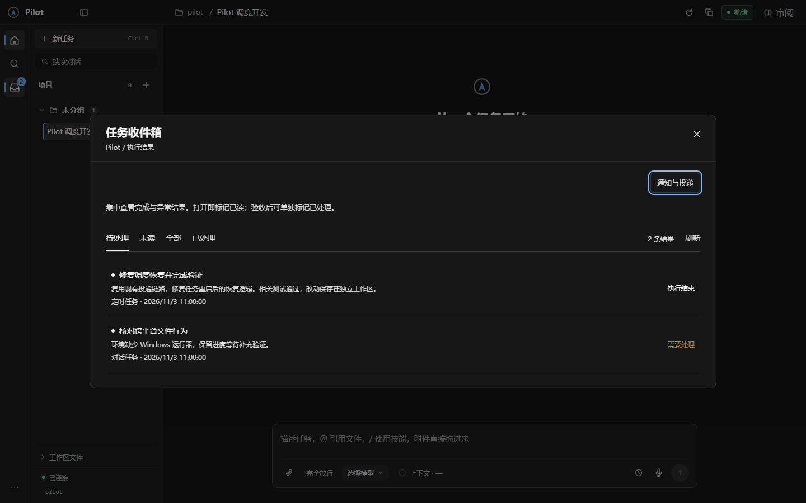
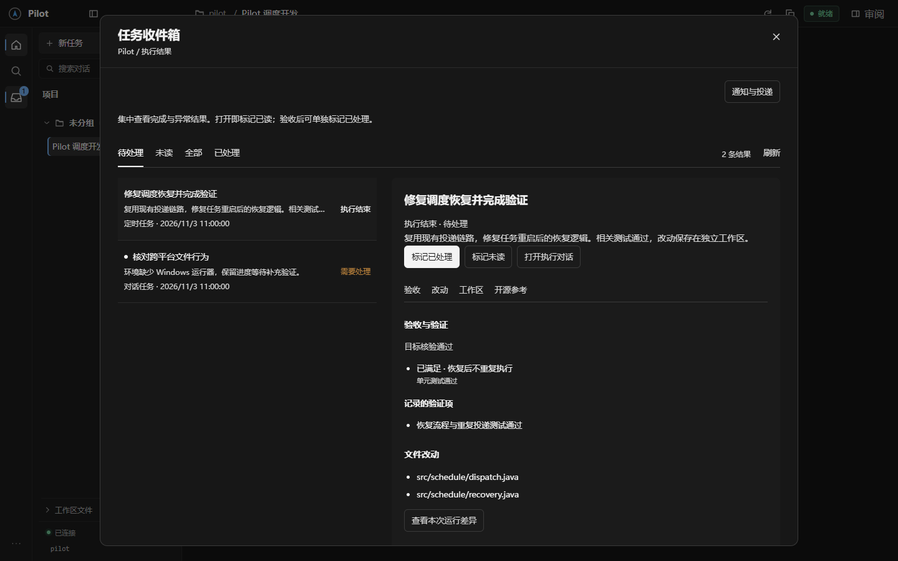
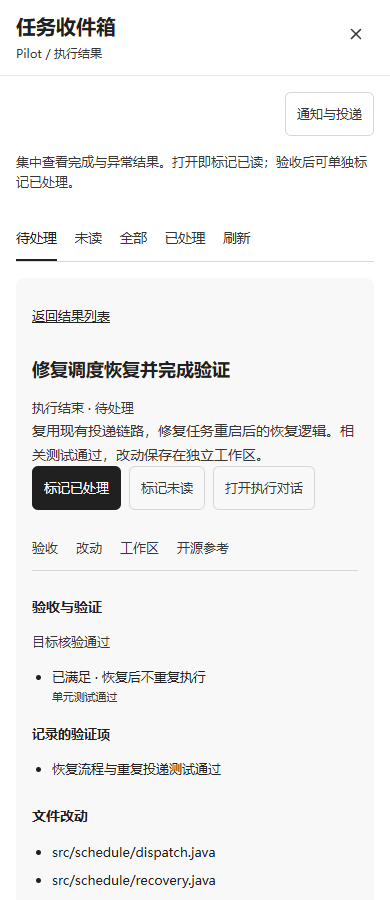

# Pilot

<p align="center"><strong>在本机工作区中运行的任务执行 Agent</strong><br>阅读项目、执行文件与工具任务，并把改动、验证和结果留给你审阅。</p>

<p align="center">
  <a href="https://github.com/zzl-qz/Pilot/actions/workflows/ci.yml"></a>
  
  
  
</p>

Pilot 提供 Web 与 Electron 工作台，并附带 Android 远程客户端。模型支持 OpenAI Chat Completions、OpenAI Responses 与 Anthropic Messages（含原生 SSE 流式与 Prompt Caching）；任务数据、工作区和执行环境由你自己的 Pilot 实例管理。

> **当前阶段：开发预览。** 功能与平台覆盖仍在验证中，不建议用于无人监督的生产工作。macOS（Seatbelt）与 Linux（bubblewrap）对主会话命令默认启用文件系统沙箱（Windows 可选独立运行器），但权限策略与本地沙箱仍不等同于多租户虚拟机隔离。

## 界面

<p align="center">
  
</p>

<p align="center">
  
  
</p>

<p align="center">
  
  
</p>

截图由项目的 Playwright UI 回归场景生成，使用模拟 API 响应和示例任务数据；展示的是实际 React 工作台界面，不代表真实模型运行或线上任务记录。

## 功能

- **可审阅的执行过程**：流式显示消息和工具活动；支持消息级分析（`plan`，源头剥离写工具）与执行（`act`）模式切换、`/review` 只读审查、审批前文件改动 Diff 预览、计划与验证状态展示，以及检查点与受校验的回退。
- **内置浏览器与独立浏览器子代理**：支持 `/browser` 与独立隔离的 `browser_agent` 子代理，提供多层同源 `iframe` / 开放 Shadow DOM 穿透、遮挡校验防偏、拖拽与视觉坐标兜底、原生弹窗与动态 `filechooser` 上传、常驻「Take Control」蓝框与 Stop 即时中断、用户接管唤醒，以及跨平台过程录像与交互式时间轴回放（任意帧暂停框选并发回坐标反馈）。
- **本机工作区与通用文件预览**：读取、搜索和精确编辑文件，工作区文件树支持快速过滤与 Git 改动徽标；内置跨平台通用文件预览（代码高亮、DOCX/XLSX/PPTX 结构化解析、PDF/图片/音视频流式预览及压缩包清单），支持 Office/PDF 生成与成果快照留存。
- **长期记忆、规则与长任务韧性**：支持外置分类长期记忆（`MEMORY.md` 索引 + `remember` 草稿人工审阅 + `read_memory` 按需检索）、`.pilot/rules` 标准 Glob 规则、两段式摘要压缩与前缀缓存复用、HTTP 429/5xx 分级退避与休眠/断网有界自动恢复，以及多会话协调看板与死锁/停滞告警。
- **可选的桌面与移动工作流**：Electron 桌面壳支持系统托盘常驻、失焦置顶审批悬浮窗、防休眠与离线自动重连，并提供基于 `jlink` 最小 JRE 的三平台自包含发行包构建脚本；Android 客户端复用本机服务，远程连接默认关闭。
- **可替换模型端点与脱敏诊断**：支持 OpenAI Chat Completions、OpenAI Responses 与 Anthropic Messages 原生流式及 Prompt Caching，可按端点与模型配置时限与计价；没有模型密钥时可用 Mock 模式体验界面流程，支持在设置页一键导出脱敏诊断包。
- **可复核的完成凭证**：把任务契约、验证证据、浏览器宿主机证据（`browserEvidence`）、改动差异与验证策略收成可导出的 JSON/Markdown；策略未通过时任务不会被标记为完成，任务还能打包成交接胶囊。

这些是项目当前实现的能力范围，不表示模型每次都能正确完成任务。详细边界见[安全与隐私](docs-public/security.md)和[功能与配置参考](docs-public/user-guide.md)。

## 快速开始

克隆仓库后，在仓库根目录按操作系统启动：

```sh
git clone https://github.com/zzl-qz/Pilot.git
cd Pilot
bash start.sh
```

Windows PowerShell 或命令提示符：

```powershell
git clone https://github.com/zzl-qz/Pilot.git
cd Pilot
.\start.cmd
```

启动器会准备所需的 Java 25、Node.js 运行环境和桌面依赖，并构建、测试后端；首次联网准备可能需要几分钟。服务默认监听 `http://localhost:9999`，也可以直接用浏览器访问。按步骤配置模型、数据目录和工作区，请看[首次启动指南](docs-public/getting-started.md)。

## 安全提示

Pilot 可以读取和修改你选定的工作区，也能执行本机命令。默认权限档位为 `AUTO`（内置删除系统/根/工作区目录硬阻断，以及强推受保护分支与敏感凭证外发的不可绕过二次确认），但普通工具仍可能不经逐项确认直接执行。第一次试用请使用可丢弃的工作区，并先切换到 `ASK` 或 `READ_ONLY`（或使用输入栏的 `plan` 分析模式）；不要把密钥或私人数据放进工作区。完整说明见[安全与隐私](docs-public/security.md)。

## 文档

| 你要做什么 | 文档 |
| --- | --- |
| 安全地完成首次启动与模型配置 | [首次启动指南](docs-public/getting-started.md) |
| 查找功能、设置项、浏览器能力与常用配置 | [功能与配置参考](docs-public/user-guide.md) |
| 确认 Pilot 不做什么、面向谁 | [范围与边界](docs-public/scope.md) |
| 了解完成凭证、验证策略即代码与任务交接 | [完成凭证与任务交接](docs-public/completion-capsule.md) |
| 了解插件如何声明依赖、升级为什么不会打掉生态 | [插件契约](docs-public/plugin-contracts.md) |
| 了解「完成」如何被验证，与外部验证工具的差异 | [与验证类工具的差异](docs-public/verification-approach.md) |
| 了解 MCP 启动命令信任与工具定义钉住规则 | [MCP 信任模型](docs-public/design-mcp-trust.md) |
| 浏览公开文档与开发入口 | [文档索引](docs-public/README.md) |
| 理解系统模块与关键数据流 | [技术导览](PROJECT_TECHNICAL_GUIDE.md) |
| 配置源码运行时自动准备 | [源码环境自动准备](SOURCE_ENVIRONMENT.md) |
| 了解桌面端、自包含打包或 Android 端 | [Electron 桌面端](pilot-desktop/README.md) · [三平台自包含发行包](pilot-desktop/RELEASE_PACKAGING.md) · [Android 与移动连接](pilot-mobile/README.md) |
| 参与贡献 | [贡献指南](CONTRIBUTING.md) |
| 了解安全边界、浏览器隐私与脱敏规则 | [安全与隐私](docs-public/security.md) |
| 私下报告安全漏洞 | [Security Policy](SECURITY.md) |

## 开发与验证

完整 CI 基线见 [GitHub Actions](.github/workflows/ci.yml)：覆盖 Windows、macOS、Linux，并包含 Android 构建与模拟器检查。服务端完整验证命令：

```sh
sh mvnw -B -ntp verify
```

Windows 可使用 Maven Wrapper 命令：

```powershell
.\mvnw.cmd -B -ntp verify
```

详细模块测试和跨平台验证范围见[贡献指南](CONTRIBUTING.md)。本机一次通过不等于其他操作系统已实机验证。

## 仓库结构

```text
pilot-core/       Agent、模型协议、工具和权限机制
pilot-server/     Spring Boot 服务、持久化与运行时装配
pilot-web/        Web 工作台与前端资源
pilot-desktop/    Electron 桌面宿主
pilot-mobile/     Android 客户端与连接组件
docs-public/      面向 GitHub 访客的公开文档与截图
evaluation/       自动化评测规格和验证记录
```

## 许可证

Pilot 自有源码和文档采用 [Apache License 2.0](LICENSE)。第三方代码和素材适用各自的许可证及版权声明。
