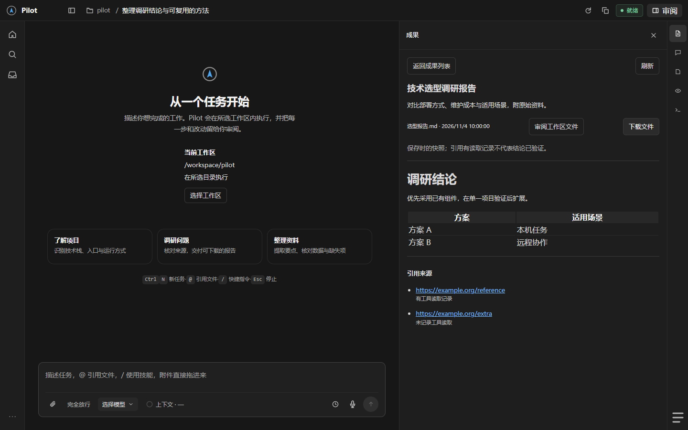
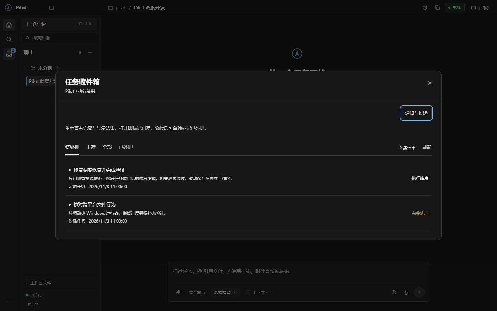
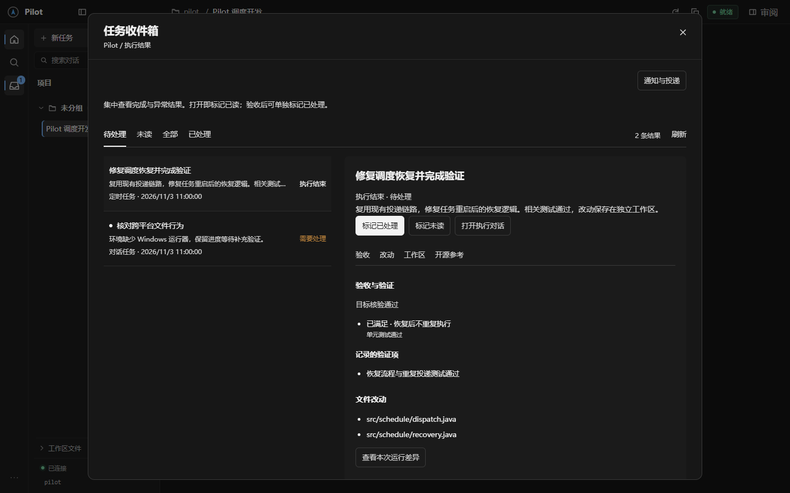
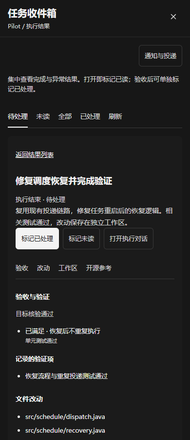
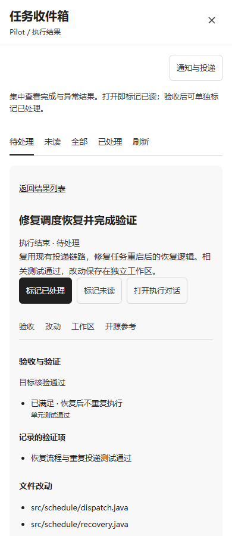
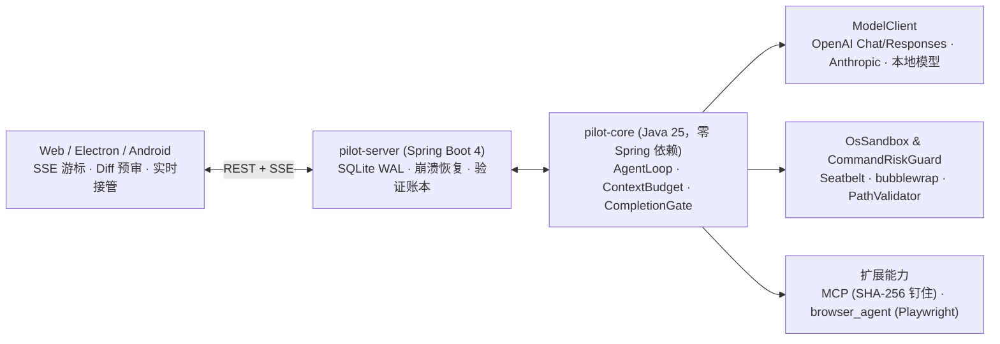

<div align="center">

# Pilot

**面向本机工作区的可验证 Coding 与任务执行 Agent**

在你的本机仓库内阅读代码、通过 OS 级沙箱执行命令、以独立浏览器子代理验证页面，并把每一步改动、测试与证据打包成可核对的完成凭证。

<p>
  <a href="https://github.com/zzl-qz/Pilot/actions/workflows/ci.yml"></a>
  
  
  
  
  
</p>

<p>
  <a href="README.md">English</a> · <strong>简体中文</strong> ·
  <a href="docs-public/zh-CN/getting-started.md">快速开始</a> ·
  <a href="docs-public/zh-CN/architecture.md">系统架构</a> ·
  <a href="docs-public/zh-CN/benchmarks.md">基准评测</a> ·
  <a href="docs-public/zh-CN/security.md">安全与隐私</a>
</p>

</div>

---

> **当前阶段：开发预览。** Pilot 面向受监督的本机开发与自动化验证。macOS（**Seatbelt**）与 Linux（**bubblewrap**）默认对主会话命令启用 OS 级文件系统沙箱（Windows 可选独立受限运行器），但本地沙箱与权限策略仍不等同于多租户虚拟机隔离。详见[安全与隐私](docs-public/zh-CN/security.md)和[范围与边界](docs-public/zh-CN/scope.md)。

## 界面展示

<p align="center">
  
</p>

<p align="center">
  
  
</p>

<details>
<summary>窄屏移动端视图（暗色 / 浅色）</summary>
<p align="center">
  
  
</p>
</details>

<sub>*截图由项目 Playwright 回归场景基于模拟 API 响应与示例数据生成，展示真实 React 工作台界面，不代表线上真实模型会话。*</sub>

---

## 核心工程特性

- **可核对的执行 Harness**：内置前置代码定位（`PreFlightLocator` + 仓库简报）、消息级 `plan`（源头剥离写工具）与 `act` 模式切换（`Shift+Tab`）、四层滞回前缀缓存友好上下文压缩，以及基于 `pilot.policy.yaml` 的运行时 `CompletionGate / LintGate` 验证门禁；验证后再改动任何文件都会自动将旧证据标为 `STALE`。
- **事件溯源运行时与崩溃恢复**：基于 **Java 25 + Spring Boot 4 + SQLite (WAL)**。状态先持久化为单调序列事件再广播，支持 SSE 断线游标无漏无重回放、进程强杀接管恢复且已完成工具零副作用重放（确定性冒烟 **8/8** 通过），以及 HTTP 429/5xx 分级退避与备用模型自动故障转移。
- **OS 级沙箱与纵深防线**：macOS **Seatbelt** / Linux **bubblewrap** 默认命令写隔离（锁定 `.git/config` 与 `hooks`，支持关闭出网）、`PathValidator` 穿透符号链接防越界、`CommandRiskGuard` 在 `AUTO` 档位仍强制执行高危命令硬红线、`SecretScrubber` 全链路凭据脱敏，以及 **SHA-256 MCP 启动配置与工具定义钉住**（防 Rug-Pull）。
- **独立浏览器子代理与实时接管**：隔离式 Playwright `browser_agent`（无文件/Shell/`evaluate` 权限），支持同源多层 `iframe` / 开放 Shadow DOM 穿透、遮挡校验、支付页硬拦截与用户 `handoff`、毫秒级抢占 **Take Control / Stop** 控制锁，以及无外部二进制依赖的 `.replay.json` 过程录像与帧级坐标框选反馈。
- **多协议与全端工作台**：原生支持 **OpenAI Chat Completions**、**OpenAI Responses** 与 **Anthropic Messages** 流式协议及 Prompt Caching，同时免密钥兼容 Ollama / LM Studio / llama.cpp / vLLM；提供 **Web**、**Electron 桌面端**（含 `jlink` 三平台自包含打包）及可选 **Android** 远程审批客户端。

---

## 架构简图



完整架构与时序说明见 [docs-public/zh-CN/architecture.md](docs-public/zh-CN/architecture.md)。

---

## 基准评测与验证

Pilot 在官方 **[ByteDance-Seed/Multi-SWE-bench-flash](https://huggingface.co/datasets/ByteDance-Seed/Multi-SWE-bench-flash)** 40 题分层子集（Java 20 + TypeScript 20，覆盖 7 个开源仓库；评测前 **40/40 Golden Patch 自检通过**）上执行严格防泄题离线评测（销毁型容器删光 `/home/*.patch` 与未来 git 历史，**0/104 作弊违规**，官方 `multi_swe_bench` 串行验收）。

**固定同模型（`gpt-6.1-sol`）严格交错 A/B 对照**（优化前 `v0-0caa2257` vs 当前 `v1-9b862d35`）：

| 指标 | `v0-0caa2257`（优化前） | `v1-9b862d35`（优化后） | 变化 |
| --- | ---: | ---: | ---: |
| **官方标准 `pass@1`** (95% Wilson CI) | **50.0%** (20/40) | **60.0%** (24/40) | **+10.0 pp** |
| **严格端到端 `COMPLETED & Pass`** | **45.0%** (18/40) | **57.5%** (23/40) | **+12.5 pp** |
| — **Java 子集**（20 题：Jackson / Gson / Jib） | 50.0% (10/20) | **75.0%** (15/20) | **+25.0 pp（5 胜 0 负）** |
| **首次编辑前定位轮次** | 9.87 | **5.85** | **-40.7%** |
| **平均模型请求轮次 / 题** | 29.0 | **23.1** | **-20.3%** |
| **重复稳定性**（`v1`，12 题 × `k=3`） | — | **`avg@3 55.6%` / `pass^3 50.0%`** | **11/12 题零方差** |
| **进程强杀与 SSE 恢复冒烟**（0-token） | — | **8 / 8 断言通过** | 工具副作用零重放 |

> **透明边界**：评测使用中转端点 `gpt-6.1-sol`，40 题全集双侧精确 McNemar `p = 0.289`（官方）/ `0.180`（严格），Java 20 题 `p = 0.0625`（5 胜 0 负）；结果仅衡量固定模型下的 Harness 工程增量，不作跨模型榜单横比。完整方法论、逐题矩阵与复现脚本见 [docs-public/zh-CN/benchmarks.md](docs-public/zh-CN/benchmarks.md) 和 [evaluation/multi-swe-bench/](evaluation/multi-swe-bench/README.zh-CN.md)。

---

## 快速开始

```sh
git clone https://github.com/zzl-qz/Pilot.git
cd Pilot
bash start.sh          # macOS / Linux
```

Windows PowerShell / 命令提示符：

```powershell
.\start.cmd
```

首次启动会自动准备私有缓存内的 Java 25、Node.js 22 与桌面依赖，构建并测试后端后在 `http://localhost:9999` 启动工作台（桌面依赖就绪时同步启动 Electron）。初次试用请先切换权限至 `ASK` / `READ_ONLY` 或使用 `plan` 模式，详细配置见[首次启动指南](docs-public/zh-CN/getting-started.md)。

---

## 文档导航

| 主题 | 文档 |
| --- | --- |
| **上手与配置** | [首次启动指南](docs-public/zh-CN/getting-started.md) · [功能与配置参考](docs-public/zh-CN/user-guide.md) · [文档总索引](docs-public/zh-CN/README.md) |
| **架构与评测** | [系统架构概览](docs-public/zh-CN/architecture.md) · [基准评测报告](docs-public/zh-CN/benchmarks.md) · [与验证类工具的差异](docs-public/zh-CN/verification-approach.md) · [完成凭证与任务交接](docs-public/zh-CN/completion-capsule.md) |
| **安全与信任** | [安全与隐私](docs-public/zh-CN/security.md) · [MCP 信任模型](docs-public/zh-CN/design-mcp-trust.md) · [范围与边界](docs-public/zh-CN/scope.md) · [安全报告政策](SECURITY.md) |
| **扩展与多端** | [插件契约](docs-public/zh-CN/plugin-contracts.md) · [桌面端与自包含发行包](pilot-desktop/RELEASE_PACKAGING.md) · [Android 客户端](pilot-mobile/README.md) |
| **源码与贡献** | [项目技术导览](PROJECT_TECHNICAL_GUIDE.md) · [贡献指南](CONTRIBUTING.md) · [Multi-SWE-bench 评测套件](evaluation/multi-swe-bench/README.zh-CN.md) |

## 开发验证与许可证

```sh
sh mvnw -B -ntp verify            # macOS / Linux
.\mvnw.cmd -B -ntp verify          # Windows
node scripts/check-doc-links.mjs   # 校验全部文档相对链接
```

Pilot 自有源码和文档采用 [Apache License 2.0](LICENSE)。
