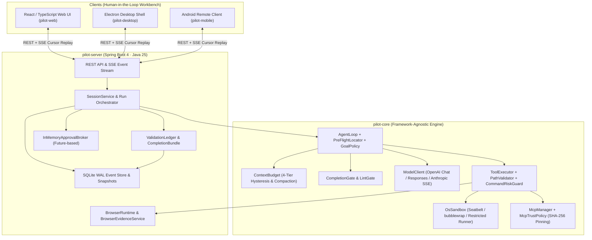

# Pilot Architecture

[English](architecture.md) | [简体中文](zh-CN/architecture.md)

> Last updated: 2026-11-27

Pilot is structured around a strict separation between **core agent contracts and execution mechanics (`pilot-core`)**, **stateful persistence, HTTP/SSE orchestration, and runtime assembly (`pilot-server`)**, and **multi-surface interactive clients (`pilot-web`, `pilot-desktop`, `pilot-mobile`)**.

## 1. System Overview



## 2. Module Boundaries

| Module | Stack | Responsibility |
| --- | --- | --- |
| `pilot-core/` | Java 25 (zero Spring dependency) | Agent loop, prompt library, context budget/compaction, OpenAI & Anthropic SSE clients, tool contracts, `PathValidator`, `CommandRiskGuard`, `OsSandbox`, `CompletionGate`, `LintGate`, MCP trust policy, Playwright browser backend. |
| `pilot-server/` | Spring Boot 4 + SQLite (WAL) | HTTP/SSE controllers, durable event store & cursor replay, run crash recovery, approval broker, file snapshot checkpoints, validation ledger, completion bundles & task capsules, multi-session coordination, scheduled tasks, diagnostics export. |
| `pilot-web/` | React + TypeScript + Vite | Streaming workbench, `plan`/`act` mode bar, approval cards with inline diff preview, checkpoint rewind UI, browser live mirror & replay frame annotation, workspace file tree & universal file preview. |
| `pilot-desktop/` | Electron | System tray host, always-on-top approval popout when unfocused, sleep prevention, offline reconnect, `jlink`-based self-contained desktop packaging. |
| `pilot-mobile/` | Kotlin / Android + Bridge | Optional local/P2P/relay remote approval client with idempotent receipt reconciliation on disconnect. |

## 3. Execution & Verification Lifecycle

Every run follows an auditable event-sourced pipeline rather than fire-and-forget generation:

```mermaid
sequenceDiagram
    participant User as Client (Web / Desktop / Mobile)
    participant Srv as pilot-server (SQLite WAL + SSE)
    participant Loop as AgentLoop & Harness
    participant Gate as CompletionGate / LintGate
    participant Env as Workspace & OsSandbox

    User->>Srv: POST /api/sessions/{id}/messages (plan or act)
    Srv->>Srv: Persist user message & run.started (seq N)
    Srv-->>User: Stream SSE events (monotonic cursor)
    Loop->>Env: PreFlightLocator + read/search tools (parallel read-only)
    Loop->>Srv: Request approval if policy requires (ASK / high-risk)
    Srv-->>User: approval.required (with Diff preview)
    User->>Srv: Approve / Reject (wakes CompletableFuture)
    Loop->>Env: Snapshot before write -> edit_file / run_command in OsSandbox
    Loop->>Gate: Candidate finish check (plan items, post-edit verification, lint)
    alt Missing verification or lint errors
        Gate-->>Loop: Inject continuation nudge (bounded retries)
    else Verified or boundedly blocked
        Srv->>Srv: Update ValidationLedger & workspace fingerprint
        Srv-->>User: run.completed / run.ended + Completion Bundle
    end
```

### Key Architectural Invariants

1. **Event-Sourced Durability & Crash Recovery**:
   - State transitions are written to SQLite (WAL mode) as immutable `EventEnvelope` records before broadcast.
   - SSE clients track the last received sequence cursor and seamlessly replay missed events on reconnect with zero duplication.
   - On abrupt server kill (`SIGKILL`) and restart, `InterruptedRunRecovery` takes over interrupted runs, preserves already-persisted tool results without re-executing side effects, and resumes cleanly (verified by `evaluation/harness/recovery-smoke.mjs`, 8/8 assertions).
2. **Prefix-Cache-Aware Context Management (`ContextBudget`)**:
   - Dual token + character guards with 4-tier hysteresis (`80% / 86% / 90% / 96%`). Below `80%`, history remains strictly append-only to preserve provider Prompt Caching prefixes.
   - Two-stage summarization compaction dry-runs local pruning first so hot prefixes are preserved when compacting long runs.
3. **Runtime-Native Verification (`ValidationLedger` & `CompletionGate`)**:
   - Instead of relying on an external prompt wrapper, verification evidence is recorded in the runtime ledger and bound to file content fingerprints.
   - Any post-verification modification automatically transitions prior verification state to `STALE`, revoking stale sign-offs.
   - Workspace-level `pilot.policy.yaml` rules enforce fail-closed completion gates.
4. **Defense-in-Depth Execution Boundaries**:
   - `PathValidator` resolves the deepest existing ancestor with `NOFOLLOW_LINKS` + `toRealPath()` to defeat symlink escapes and dangling links.
   - `CommandRiskGuard` enforces non-bypassable hard blocks (deleting root/home/workspace, even via nested shells) and mandatory confirmations (force-pushing protected branches, credential exfiltration).
   - `OsSandbox` wraps `run_command` with macOS Seatbelt / Linux bubblewrap (default-deny write, `.git/config` & `hooks` locked read-only, optional network block via `PILOT_EXECUTION_COMMAND_NETWORK=false`).
   - `McpTrustPolicy` pins `SHA-256(command + args + env)` and individual tool definitions (`toolHash`) to prevent silent rug-pull mutations.
   - `SecretScrubber` strips Bearer/Basic tokens, provider prefixes, PEM blocks, and embedded URL credentials across model errors, command outputs, logs, and exported diagnostics.
5. **Isolated Browser Subagent (`browser_agent`)**:
   - Runs Playwright in an isolated subagent context with `evaluate`, filesystem, and shell tools removed.
   - Supports same-origin nested `iframe` and open Shadow DOM traversal, occlusion checks, coordinate fallback, hard-blocked payment pages with user `handoff`, instant preemption via **Take Control / Stop**, and zero-dependency `.replay.json` session recording with frame-level bounding-box feedback.

## Further Reading

- [PROJECT_TECHNICAL_GUIDE.md](../PROJECT_TECHNICAL_GUIDE.md) — Deep code-reading roadmap by subsystem (Chinese)
- [Security & Privacy](security.md) — Permission modes, sandbox coverage, browser privacy, and secret scrubbing
- [Completion Bundle & Policies](completion-capsule.md) — Completion bundles, `pilot.policy.yaml`, and task capsules
- [MCP Trust Model](design-mcp-trust.md) — Startup command hashing and tool definition pinning
- [Benchmarks & Verification](benchmarks.md) — Reproducible Multi-SWE-bench evaluation results
