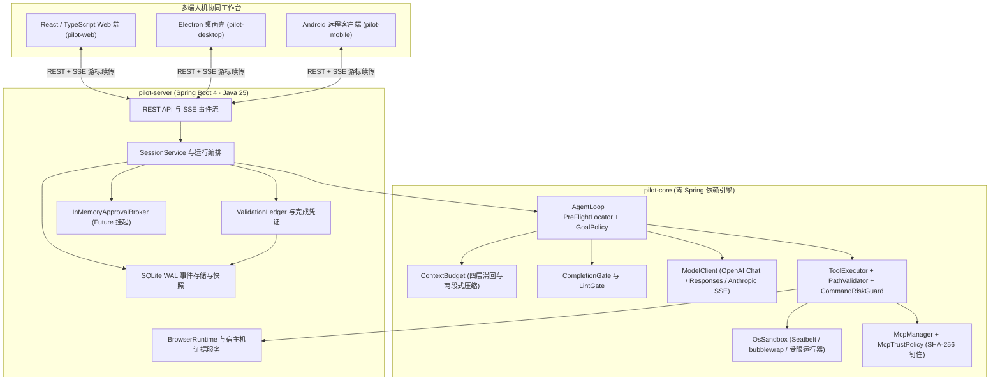

# 系统架构概览

[English](../architecture.md) | [简体中文](architecture.md)

> 最后更新：2026-11-27

Pilot 采用清晰的三层边界架构：**无框架依赖的核心引擎与契约层（`pilot-core`）**、**持久化状态机与运行时装配层（`pilot-server`）**，以及**多端人机协同工作台（`pilot-web` / `pilot-desktop` / `pilot-mobile`）**。

## 1. 整体架构图

## 2. 物理模块划分

| 模块 | 技术栈 | 职责 |
| --- | --- | --- |
| `pilot-core/` | Java 25（不依赖 Spring） | Agent 执行循环、提示词库、四层滞回上下文预算与压缩、OpenAI/Anthropic SSE 客户端、工具契约、`PathValidator`、`CommandRiskGuard`、`OsSandbox`、`CompletionGate`、`LintGate`、MCP 信任策略与 Playwright 后端。 |
| `pilot-server/` | Spring Boot 4 + SQLite (WAL) | REST/SSE 控制器、事件溯源持久化与游标重放、进程强杀接管恢复、审批挂起与超时拒签、写前快照检查点、验证账本、完成凭证与交接胶囊、多会话协调、定时任务及脱敏诊断导出。 |
| `pilot-web/` | React + TypeScript + Vite | 流式工作台、`plan`/`act` 模式切换、带 Diff 预览的审批卡、检查点校验回滚、浏览器镜像与录像帧级框选、工作区文件树与通用预览。 |
| `pilot-desktop/` | Electron | 系统托盘常驻、失焦置顶审批悬浮窗、防休眠、离线自动重连及基于 `jlink` 最小 JRE 的三平台自包含打包。 |
| `pilot-mobile/` | Kotlin / Android + Bridge | 可选局域网/P2P/中继远程审批客户端，断网重连按幂等回执核对不盲目重发。 |

## 3. 五项核心架构不变量

1. **事件溯源与崩溃恢复**：所有状态先以不可变 `EventEnvelope` 写入 SQLite WAL 再向 SSE 广播，断线按单调序列游标无漏无重回放；进程强杀重启后 `InterruptedRunRecovery` 接管未完成会话，已落盘工具结果直接复用不重放副作用（`recovery-smoke.mjs` **8/8** 确定性断言通过）。
2. **前缀缓存友好的上下文治理（`ContextBudget`）**：`80% / 86% / 90% / 96%` 四层滞回阈值，80% 以下保持严格只追加以保护 Prompt Cache；越过预压线先只读预演本地清理，避免盲目打穿热前缀。
3. **运行时内生验证（`ValidationLedger` 与 `CompletionGate`）**：验证证据与文件指纹绑定，后续任何改动都会把旧证据标记为 `STALE` 并撤销旧验收；支持 `pilot.policy.yaml` 验证策略即代码（fail-closed）。
4. **纵深安全边界**：`PathValidator` 穿透符号链接解析真实祖先；`CommandRiskGuard` 在 `AUTO` 下仍执行不可绕过删根/工作区硬阻断与强推/凭证外发确认；`OsSandbox` 在 macOS/Linux 默认启用 Seatbelt/bubblewrap 写隔离并锁定 `.git/config` 与 `hooks`；`McpTrustPolicy` 钉住启动命令与工具定义哈希防 Rug-Pull；`SecretScrubber` 全链路脱敏。
5. **隔离浏览器子代理（`browser_agent`）**：独立上下文且禁用 `evaluate`、文件与 Shell 工具，支持同源 `iframe`/Shadow DOM 穿透、支付页硬拦截与用户 `handoff`、毫秒级抢占 **Take Control / Stop**，以及 `.replay.json` 过程录像与帧级坐标框选反馈。

## 延伸阅读

- [项目技术导览（详细源码阅读路线）](../../PROJECT_TECHNICAL_GUIDE.md)
- [安全与隐私](security.md)
- [完成凭证、验证策略与任务交接](completion-capsule.md)
- [MCP 信任模型](design-mcp-trust.md)
- [基准评测与验证报告](benchmarks.md)
